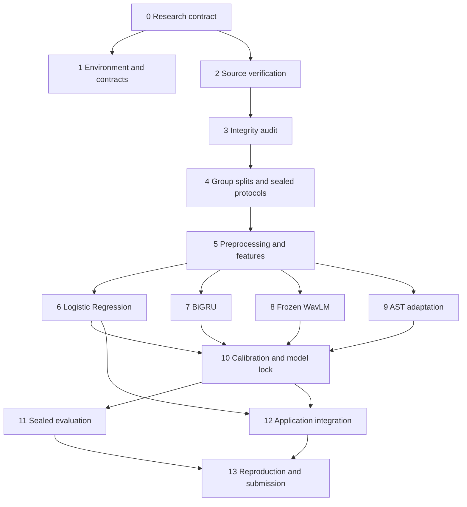

# EchoProof — Comprehensive Phase-by-Phase Implementation Plan

**Planning date:** 28 October 2026  
**Delivery horizon:** eight weeks, four developers  
**Status:** proposed implementation plan; no datasets downloaded, experiments run, or performance claims established by this document.

## 1. Authority, assumptions, and intended outcome

This plan uses the user's MVP specification, `COUNCIL.md`, and `EchoProof_Complete_Project_Guide.html`. These are the only repository inputs consulted. All other paths named below are **proposed deliverables**, not evidence about existing repository contents. Course requirements described here are inherited from the HTML guide; underlying course documents were not independently read. Public technical sources are cited where used.

Apply the council's independent analysis, anonymized review, and chairman synthesis to implementation decisions. The user's requested Markdown deliverable takes precedence over the council file's chat-only output instruction. Five advisors and five reviewers ran in batches because only three child-agent slots were available. Reviewers received anonymized, condensed advisor responses in a reordered A–E mapping, without advisor identities or the other reviews. The primary agent performed the chairman synthesis. Section 16 records the resulting decisions and this adaptation of the council procedure.

Build two connected deliverables:

1. A reproducible research system comparing Logistic Regression, a two-layer bidirectional GRU, frozen WavLM-Base-Plus with a trained head, and partially fine-tuned Audio Spectrogram Transformer (AST).
2. A working Python application that accepts speech recordings, validates and preprocesses them, returns a recording-level genuine/TTS assessment, presents a carefully labeled confidence/model score, and displays waveform and log-mel spectrogram visualizations.

The central research question is which **complete approach** generalizes best to previously unseen TTS generators under controlled data partitions. WavLM and AST are both Transformer-based. Their required comparison changes representation and training regime simultaneously; it does not isolate architecture alone. No architecture is presumed to outperform another.

### Scope and success contract

| Area | Required MVP behavior | Explicit boundary |
|---|---|---|
| Task | Offline recording-level binary classification; `0=genuine`, `1=tts` | No speaker identification or proof of authenticity |
| Language | Verified English speech | Other languages are unvalidated; automatic language identification is optional |
| Synthetic scope | Text-conditioned speech, including documented text-based cloning | Exclude voice conversion, singing, edited/mixed clips, and replay-only attacks from validated claims |
| Inputs | WAV and a tested MP3 decoding path; browser recording after upload works | Initial app limit: 60 seconds, 25 MiB upload, bounded decoding |
| Outputs | Likely genuine / likely TTS; inconclusive or insufficient-input states when justified | A high model score is not certainty about an arbitrary real-world recording |
| Visuals | Time-labeled waveform and frequency/time-labeled log-mel spectrogram | Visuals describe audio; they do not prove synthesis |
| Research | Four trained approaches, known/unseen/external evaluation, noise/compression stress tests | No standalone CNN, XGBoost, or required ensemble |
| Reproducibility | Immutable provenance, group-safe splits, configs, checkpoints, metrics, reloadable inference bundle | A notebook screenshot alone does not establish reproducibility |
| Performance | Proposed warm end-to-end p95 target of 5 seconds for a 10-second clip on named demo hardware | This is an engineering target to measure, not an achieved result |
| Submission | Working demo, model/data documentation, contribution log, at least 10 substantive report pages; plan for 12 | Scientific limitations and incomplete requirements must remain visible |

All numerical hyperparameters, sample sizes, thresholds, budgets, and latency targets below are starting proposals. Freeze actual choices using development evidence before final evaluation.

## 2. Team, delivery schedule, and dependency structure

### Ownership

| Developer | Primary ownership | Mandatory independent review |
|---|---|---|
| A — Data and features | Dataset adapters, provenance, audit, grouping, preprocessing, EDA, feature schemas | D reviews leakage; B reviews feature contracts |
| B — Baseline and recurrence | LR, BiGRU, reusable trainer, sampling/imbalance policy, experiment ledger | C reviews masking/gradients; A reviews data use |
| C — Pretrained representations | WavLM, AST, processor compatibility, embedding cache, compute profiling | B reviews optimizer/freezing; D reviews bundle loading |
| D — Evaluation and application | Recording aggregation, metrics, calibration, Streamlit, packaging, integration | A reviews benchmark eligibility; C reviews score parity |

Each module has one primary owner and one reviewer. All four developers contribute report sections and must be able to explain the full pipeline. Hold two 20-minute evidence reviews weekly: demonstrate an artifact, inspect the next gate, and update the risk/compute ledger. Record decisions and contributions as work happens.

### Eight-week milestones

| Week | Primary milestone | Parallel work | Required evidence before closing week |
|---|---|---|---|
| 1 | Research contract, environment, source eligibility | Small data sample; app flow sketch; GPU access reservation; report outline | Verified source samples, identity mapping, license notes, smoke tests, budget estimate |
| 2 | Audited manifests and locked protocols | Training-only EDA; feature implementation; evaluator fixtures | No prohibited leakage, usable external benchmark, both-class validation subsets |
| 3 | Complete representation contract and LR | Shared trainer; Streamlit integration; pretrained compatibility probes | LR predictions from CLI and UI agree; plots/export work on fixtures |
| 4 | BiGRU and development tuning | WavLM extraction; AST memory/gradient pilot | Packed-sequence tests, GRU bundle, measured AST feasibility |
| 5 | Frozen WavLM/head and AST warm-up | AST adaptation; calibration tooling; packaging | Cache/direct parity; frozen modules verified; both protocols scheduled |
| 6 | Finish AST adaptation and all model/protocol fits; lock selection | Controlled ablations, calibration, threshold fitting, latency qualification | Eight final model/protocol bundles; selected production bundle locked |
| 7 | Sealed evaluation and deployment verification | Report tables, external/corruption suites, error taxonomy | Fixed recording predictions, working app, clean-environment run |
| 8 | Reproduction audit, final report, defense | Final uncertainty analysis, demo rehearsal, offline backup | Submission checklist complete; results regenerated from saved predictions |

Weeks describe staffing, not permission to bypass dependencies. The critical path is:



An early app scaffold and pretrained compatibility tests may proceed with labeled fixtures. They must not inspect final-test results or cause held-out generator data to enter development.

## 3. Phase 0 — Freeze the research and product contract

**When:** week 1, days 1–2. **Owner:** D with all team members. **Dependency:** supplied specification and guide.

### Implementation tasks

1. Write the problem statement, label semantics, supported inputs, exclusions, research questions, and measurable engineering targets.
2. Define four questions: whether temporal features help over fixed summaries; whether pretrained speech representations transfer; whether AST adaptation improves over its frozen-head stage; and how each approach degrades under unseen generators, external source shift, and corruption.
3. Predeclare the production-selection rule: among deployable Protocol B candidates, maximize recording-level macro F1 on unseen-generator selection validation, break exact ties by lower EER, then lower genuine FPR, then lower measured latency. Use known-generator development performance as a recorded sanity check. Define any minimum acceptable quality before seeing model results; do not invent an accuracy guarantee.
4. Separate checkpoint/hyperparameter selection, calibration fitting, threshold selection, and final assessment. Freeze a decision threshold policy, initially maximizing macro F1 on operating validation. A proposed FPR-constrained alternative must be declared as a separate policy before results are inspected.
5. Define the deployment candidate as a specific model **and protocol-trained artifact**. Default to the strict unseen-generator Protocol B artifact so the central generalization claim corresponds to what the app runs. Protocol A models remain the broader known-generator comparison.
6. Set the known-vs-unseen information boundary: complete and freeze Protocol B development before using the final held-out family in any Protocol A training or result-driven analysis. Common engineering fixes after this boundary require a documented change assessment and, where they alter learned behavior, renewed evaluation controls.
7. Record unresolved implementation decisions with owners and deadlines: dataset identity mapping (A, week 1), English external eligibility (A/D, week 2), GPU slot (C, week 1), latency hardware (D, week 1), instructor interpretation of two-source usage (D, week 1). Work proceeds on the stricter two-source plan without reading additional repository materials.

**Deliverables:** proposed `docs/problem_statement.md`, `docs/research_contract.md`, `docs/decision_log.md`, task board, dated gate checklist.

**Exit gate G0:** all owners can explain the positive class, unit of prediction, independent split unit, selection data, final-test data, and conditions under which a requirement remains unmet.

## 4. Phase 1 — Engineering foundation and shared contracts

**When:** week 1; maintain throughout. **Owners:** B/C for environment, D for interfaces. **Dependency:** G0.

### Environment and package layout

Use an isolated supported Python environment; choose compatible package versions by smoke test, then lock them. Core stack: NumPy, pandas, PyArrow, SciPy, SoundFile, librosa, scikit-learn, PyTorch, Transformers, Matplotlib, Seaborn, PyYAML, pytest, and Streamlit. Add FFmpeg for verified MP3 handling and corruption experiments. Avoid unnecessary web services, databases, queues, or a second frontend framework in the MVP.

Proposed layout:

```text
configs/                       # base, protocols, features, four models, app
src/echoproof/
  data/                        # adapters, manifests, audit, groups, chunks
  features/                    # handcrafted, log-mel, pretrained adapters/cache
  models/                      # lr, bigru, wavlm_head, ast_detector
  training/                    # trainers, samplers, checkpointing, seeds
  evaluation/                  # aggregate, metrics, calibration, bootstrap
  inference.py                 # shared predict_recording entry point
  cli.py                       # reproducible pipeline commands
app/                           # Streamlit presentation only
tests/fixtures/                # small licensed or generated audio fixtures
data/raw/                      # immutable originals; no large audio in Git
data/manifests/                 # provenance, clean inventory, exclusions
data/splits/                    # protocol and validation-role assignments
data/processed/                 # canonical audio and chunk references
data/features/                  # versioned feature/embedding caches
runs/<run_id>/                  # resolved config, checkpoint, metrics, hashes
bundles/<bundle_id>/            # complete deployable inference artifacts
reports/                       # EDA, tables, model/data cards, final report
docs/                          # decisions, operating instructions, contributions
```

Implement package imports and CLI entry points explicitly; this is a proposed new structure, not an assessment of existing code. Notebooks may call these modules for exploration; they must not contain the only implementation of a production transformation.

### Data and inference interfaces

| Contract | Required fields / behavior |
|---|---|
| Recording manifest | `recording_id`, original relative path, dataset/revision, label, method type, generator family/version, language, source utterance, source speaker, target voice, reference ID, transcript hash, duration, sample rate, channels, codec, checksums, quality flags, retained/exclusion reason, license reference |
| Split assignment | `protocol_id`, `recording_id`, `group_id`, partition, validation role, family policy, split version/hash |
| Chunk map | `chunk_id`, parent recording, group/split, start/end sample and seconds, valid sample count, preprocessing hash; no orphan chunks |
| Feature batch | Tensor/array, recording/chunk IDs, labels when available, valid lengths/masks, feature schema hash |
| Prediction row | Run/bundle/protocol, recording ID, raw aggregated TTS score, calibrated score if applicable, threshold, binary prediction, processing status, duration, chunk count |
| Model adapter | Load immutable config/weights; score canonical chunks; return finite class-1 probabilities with stable mapping |
| Inference result | Status, user-facing assessment, score type/value, duration/coverage, quality warnings, model version, timings, export-safe metadata |

Use namespaced identities across datasets. Missing identities remain null; a shared literal `unknown` must never connect every unknown speaker into one group. Validate schema types, unique IDs, paths, label values, and foreign-key relationships.

### Reproducibility and compute

Seed Python, NumPy, PyTorch, data loaders, crop sampling, and augmentation. Record worker count, deterministic settings, operating system, CPU/GPU, RAM/VRAM, CUDA/driver, dependency lock, source revision, and config hashes. Seeds do not guarantee identical results across releases or devices; use tested numerical tolerances and preserve the environment. [PyTorch reproducibility guidance](https://docs.pytorch.org/docs/2.14/notes/randomness.html).

Measure approximately 100 representative batches for throughput and peak memory. Estimate extraction, training, validation, final scoring, and artifact storage separately. Reserve 25% of available compute for failed runs, integration, and recovery. A 12–16 GB GPU is a planning target only; begin AST at microbatch 2. CPU support is mandatory for LR and smoke/inference paths where practical; full pretrained training on CPU is not assumed feasible within eight weeks.

Budget for **at least eight final fits**: four architectures under each of Protocols A and B. External and corruption suites score frozen models and do not require new fits. Frozen-AST warm-up is part of each AST run, with a saved stage checkpoint. Limit neural searches initially to a baseline plus one targeted alternative per model/protocol; LR has eight inexpensive regularization/weighting candidates. Repeat shortlisted configurations with three seeds only if the measured budget allows. Account for all trials in comparisons.

**Exit gate G1:** a WAV decodes/resamples, all four representations complete a forward pass, an AST backward memory probe succeeds on fixtures, artifact storage persists, and hardware/budget records exist. Repeat representative AST throughput profiling in week 4 after the real data contract is ready. Pretrained downloads are pinned by revision; licenses are recorded.

## 5. Phase 2 — Acquire and verify two eligible data sources

**When:** week 1, with reconciliation complete by week 2. **Owner:** A; **reviewer:** D. **Dependencies:** G0 and environment for decoding.

### Primary source: PhonemeDF

Use the guide's proposed release v1.0.1 as the starting candidate. Retain genuine audio plus verified MeloTTS, XTTS v2, Chatterbox TTS, and VITS; exclude Chatterbox VC, FreeVC, and StarGAN VC. A product name alone is insufficient evidence of method type. Verify archive naming, paired source utterances, reference voices, and label metadata against the authors' materials. [PhonemeDF authors' repository](https://github.com/Vamshi-Nallaguntla/PhonemeDF).

The guide reports 28,539 real and 199,773 synthetic recordings across TTS **and** VC, and approximately 41.4 GB compressed for the required real/four-TTS archives. These are guide-sourced planning figures, not locally audited counts. The release page returned HTTP 429 during this planning pass; reverify its metadata/checksums before acquisition. Do not use full-corpus duration as the TTS-only duration. [Target release](https://zenodo.org/records/19522979).

### External source: MLAAD-tiny

Default to a sealed English external benchmark with verified genuine and TTS examples. Its card describes roughly 6,000 genuine and 6,400 synthetic files, while the viewer lists 15,290 rows; the synthetic description includes English and German. Resolve these discrepancies from actual metadata and files. Synthetic licensing is described as CC BY-NC 4.0; genuine audio retains its source license. [MLAAD-tiny dataset card](https://huggingface.co/datasets/mueller91/MLAAD-tiny).

Do not inherit the viewer's single `train` partition as a scientific split. If both English classes and provenance cannot be verified, pause external scoring and identify a documented replacement by the end of week 2. Record any substitution before final model selection. A replacement must have both classes, usable method/language metadata, permissions, and enough independent groups. Never repair this by comparing English genuine with German synthetic speech.

### Acquisition work packages

1. Download documentation and a small representative sample before full archives. Record URLs, retrieval dates, immutable revisions, available license texts, publisher checksums, and local SHA-256 hashes.
2. Implement one dataset adapter per source. Normalize only documented label/method mappings; quarantine ambiguous examples. Keep raw filenames and metadata alongside normalized fields.
3. Use resumable downloads and safe archive extraction with path traversal checks. Preserve directory structure and reject accidental collisions.
4. Store raw recordings separately from all transformations. Record source and synthesized target identities independently; reference audio is not automatically a labeled genuine training sample.
5. Reconcile counts through publisher inventory → downloaded → decoded → in-scope → deduplicated → partitioned → sampled. Report counts by class, generator, language, and source.
6. Audit usage and redistribution conditions before publishing datasets or examples. A research model package can contain retrieval instructions and hashes instead of redistributing restricted audio.
7. Construct a 500–1,000-recording integration subset **after** full group assignment. Later target 20,000–40,000 recordings only if feasible; sample groups reproducibly and use the same selected recordings for all approaches within each protocol.

The default satisfies two-source use through primary training and external evaluation. If the course requires both sources in training, reserve a separate group-disjoint external development subset **before tuning**, include both classes from each source, and keep a sealed external remainder. Treat mixed-source training as a separate declared experiment and exclude the final held-out generator family from every development source.

**Deliverables:** dataset cards, source/license inventory, immutable raw manifest, download inventory, adapter tests, count reconciliation, eligibility decision for source two.

**Exit gate G2:** source labels/methods are verified, both external English classes exist, required identity fields are understood, storage is sufficient, and unresolved usage restrictions are documented. Missing permission to redistribute does not authorize publication of audio.

## 6. Phase 3 — Integrity audit, cleaning, and exploratory analysis

**When:** weeks 1–2. **Owner:** A; **reviewers:** B/D. **Dependency:** verified sample and adapters.

### Fixed integrity checks before splitting

1. Decode original files; reject empty, unreadable, corrupt, or non-finite audio with structured reasons. Capture codec, channel count, duration, rate, peak, RMS, clipping proportion, and silence measurements.
2. Compute byte hashes and canonical decoded-PCM hashes using a documented deterministic representation. A hash identifies exact equivalence under that representation; it does not establish perceptual equivalence.
3. Detect near-duplicate candidates using robust fingerprints or coarse audio descriptors and nearest-neighbor search, followed by aligned waveform/similarity checks and manual review of ambiguous cases. Record algorithm/version, threshold, evidence, and disposition. Shared words alone do not prove duplicate recordings.
4. Form duplicate groups before partitioning. Conflicting labels are quarantined. Keep one exact-duplicate representative or keep all members in one partition with explicit evaluation weighting; default to one representative to avoid inflated counts.
5. Distinguish deterministic integrity rules from data-dependent quality decisions. Inspect only development/training data to choose silence, duration, or clipping exclusions. Apply frozen rules uniformly across partitions and report differential removal rates.
6. Preserve originals. Canonicalization for hashing and integrity inspection may precede partitioning; **training segments, augmentation, learned normalization, and outcome-guided cleaning may not**.

### EDA work packages

After Phase 4 assigns partitions, generate outcome-guided figures from training data. Before that, limit inspection to provenance/integrity and administrative coverage. Test integrity summaries do not authorize model-error-driven redesign.

| Exported diagnostic | Required breakdown | Decision it supports |
|---|---|---|
| Class counts | Source × label × split | Class strategy and denominator transparency |
| Generator counts | Family/version × split | Coverage and held-out exclusions |
| Duration histograms | Class/source/generator | Crop policy, padding and length shortcuts |
| Waveforms | Genuine/TTS pairs and flagged examples | Amplitude, silence, clipping review |
| Log-mel spectrograms | Same display scale for paired examples | Acoustic comparison without authenticity claims |
| RMS and silence distributions | Including leading/trailing silence | Detect source/label artifacts |
| MFCC distributions | Per coefficient and class | Feature behavior and extreme values |
| Rate/codec/channel charts | Source and class | Acquisition shortcuts |
| Identity/group-size report | Source speakers, target voices, references | Feasibility of declared independence |
| Quality/exclusion table | Reason × source × label × generator | Bias introduced by cleaning |

Save plots as PNG plus vector PDF/SVG where practical, with source table, script/config, split hash, and a written interpretation. Review 10–20 development examples per generator and both classes, including flagged examples. Use shared spectrogram scales and units.

Train a diagnostic metadata-only classifier using duration, RMS, silence, original rate, and codec, with the same group-safe development assignments. It is a shortcut probe, not a fifth required detector. Also compare acoustic features with/without energy/silence and evaluate a duration-matched development subset. Any fitting, feature selection, or dimensionality reduction uses training data only.

**Deliverables:** raw/clean manifests, exclusion ledger, duplicate evidence, audit summary, at least six decision-relevant figure families (all listed diagnostics implemented), reproducible EDA command, short shortcut-analysis memo.

**Exit gate G3:** every inclusion/exclusion is explainable, ambiguous labels are absent, duplicate candidates have a disposition, and the split builder receives verified relationships. Final EDA closure follows G4.

## 7. Phase 4 — Lock leakage-safe experimental protocols

**When:** week 2. **Owner:** A; **reviewer:** D. **Dependencies:** G3; no model training before G4.

### Group construction and assignment

Build a relationship graph. Connect verified shared source utterances, genuine/synthetic relatives, exact/confirmed near-duplicates, and derivative parents. Add all source-speaker relationships for the core source-speaker-disjoint claim. Add target-voice and cloning-reference relationships only for protocols claiming those forms of independence. Compute connected components and assign each component once.

Transcript identity is a review signal; link verified common source utterances and document the handling of independently spoken identical text. Distinguish source-speaker, output-voice, and textual-content independence. Unknown metadata prevents a stronger claim; it does not justify invented IDs.

For Protocol A, target approximately 70% train / 15% validation / 15% test by recordings while assigning whole groups. Use deterministic grouped allocation with class/family coverage objectives and report achieved proportions by recordings, groups, and duration. Group-aware stratification attempts balance; it does not guarantee these exact ratios. [StratifiedGroupKFold documentation](https://scikit-learn.org/stable/modules/generated/sklearn.model_selection.StratifiedGroupKFold.html).

If target-voice constraints form a giant component, retain source-speaker/utterance independence, report target/reference overlap, and narrow the claim. Do not silently break components to hit percentages. Fail any binary partition that lacks a class; address insufficient independent groups by changing the declared protocol before training.

### Required protocols

| Protocol | Training/development | Final assessment | Required fitted artifacts |
|---|---|---|---|
| A — Known generators | Four eligible families in training groups; known-family development groups | Held-out source groups with known families | Four separately trained approaches |
| B — Strict unseen generator | Example: MeloTTS + VITS train; XTTS v2 unseen validation; Chatterbox TTS absent from all development | Genuine + Chatterbox TTS from final source groups | Four separately trained approaches; default production pool |
| C — External transfer | No fitting or threshold adjustment on external test | Verified English MLAAD-tiny, both classes; identify family overlap | Score locked B models; A external results optional if budget permits |
| D — Corruption | Development corruption settings declared before lock | Paired clean/noisy/compressed copies of locked test recordings | Reuse frozen models and thresholds |

Allocate source groups before applying B's family filters. Training groups' genuine originals cannot reappear as controls beside held-out synthetic derivatives. For B, maintain known-family development controls and unseen-family validation in distinct declared subsets. The actual filtered class proportions may differ from A; document them rather than asserting identical data across protocols.

All four approaches share training/validation/test recording IDs **within each protocol**. They need not share IDs between A and B, whose questions and training family sets differ. An unseen-family result from an A model trained on that family is invalid.

Maintain a generator alias/version registry. Check external sources for the final held-out family and related forks before admitting any external development data. Cross-dataset transfer is not automatically unseen-generator transfer. If architecture-family independence is uncertain, use the narrower claim “unseen dataset system ID.” Document pretrained-source overlap as a separate limitation.

### Validation roles and information boundaries

Split the validation allocation by independent groups into selection, calibration, and operating-threshold subsets; an initial 50/25/25 division of validation groups is a proposal, subject to support counts. Each required binary subset must contain both classes and sufficient independent groups for interpretable estimates. Report counts rather than relying on a universal minimum.

Selection validation drives hyperparameters and checkpoints. Calibration validation fits only the score mapping. Operating validation sets the deployed threshold and evaluates calibration reliability/coverage. Use selection validation at fixed threshold 0.5 for comparable checkpoint macro F1 before final calibration; do not optimize a threshold anew at every epoch. If support is inadequate, enlarge development allocation or implement explicitly nested group-aware cross-fitting with out-of-fold predictions and documented fit roles. Do not quietly reuse the final test.

Before G4, D must produce an evaluation-precision worksheet: counts of independent groups and genuine/TTS recordings for each panel, anticipated uncertainty for genuine FPR under several plausible error rates, and sensitivity to within-group dependence using development-only pilot information. Predeclare the interval width the team would consider useful and enlarge the eligible evaluation cohort where possible. If the data cannot support that precision, narrow the claim and report the limitation. Thousands of crops from a few speakers do not establish precise population error rates. One held-out generator supports a finding about that generator, not a population-wide claim about all unseen TTS systems.

**Cross-protocol firewall:** lock B hyperparameters, weights, aggregation, calibration, and thresholds before any A development uses Chatterbox TTS. Then execute the predeclared A development procedure; A findings cannot retroactively tune B. This ordering prevents the team from indirectly learning about B's held-out family. Optional generator rotations require their own nested selection plan and independent fits.

### Assertions and immutable outputs

- No verified source utterance, duplicate group, declared speaker group, parent recording, or mandatory reference identity crosses partitions.
- Each recording occurs once per protocol assignment; every chunk inherits that assignment.
- No B training or development file belongs to its final unseen family; exclusion is checked across sources.
- Both classes exist in every binary metric panel; per-generator panels declare the genuine comparison set.
- Compare cross-corpus fingerprints and source identities; quarantine or disclose unresolved overlap before final scoring.
- Store partition, validation-role, sample-selection, and relationship-graph hashes; log all intentional revisions.
- Make final-test paths unavailable to ordinary train/tune commands; require an explicit sealed-evaluation mode and a completed bundle lock record.

**Deliverables:** protocol manifests, group graph/report, family registry, validation-role manifests, leakage tests, fixed comparison recording lists, test-access log.

**Exit gate G4:** zero prohibited overlaps, feasible group counts, documented achieved proportions, reviewer-approved final-test boundaries, and all model owners using identical protocol manifests.

## 8. Phase 5 — Shared preprocessing and model-specific representations

**When:** weeks 2–3. **Owner:** A with B/C. **Dependency:** G4 for generated crops and fitted transforms.

### Canonical waveform and chunk policy

Decode to finite float32, convert channels by a documented mean-channel rule, check for stereo cancellation, resample once to 16 kHz with a pinned method, and preserve time offsets. Use consistent integer-to-float scaling. Default to no denoising, no per-clip peak/loudness normalization, no pitch change, and no aggressive silence trimming. Model-specific pretrained normalization remains separate and versioned.

Use 4-second windows (64,000 samples). For training, initially choose one deterministic-seeded random crop per recording per epoch; use fixed crop banks where caching is required and record this difference. Prevent duration from determining training weight. For static multi-crop LR/embedding datasets, give each recording equal total sample weight, then apply any declared class treatment.

For evaluation, use deterministic starts at 0, 2, 4, … seconds while full 4-second windows fit; append a final start at `duration−4` if needed to cover the tail, without duplicating a start. For recordings shorter than 4 seconds, make one crop with true valid length and right-padding only where required. This avoids tiny tail fragments while covering the entire eligible recording. Save exact sample coordinates. All four models use these same evaluation boundaries.

Do not repeat audio to fill a crop. Initially treat less than one second of usable speech as insufficient; validate this threshold on development data and freeze it. VAD/energy checks produce quality flags; they are not authenticity or language detectors. Distinguish total duration from estimated speech duration. Keep the research eligibility policy and app input policy explicit; never silently truncate a long recording and report full coverage.

Aggregate chunk scores using the arithmetic mean of class-1 probabilities. Overlap changes frame representation frequency; document it and keep it identical across models. Alternatives such as duration-weighted pooling are development ablations, never test-driven choices. Mean aggregation does not support reliable localization of partially synthetic audio.

### A. Handcrafted features for LR

Implement MFCCs, delta MFCCs, spectral centroid, bandwidth, rolloff, flatness, zero-crossing rate, RMS, and voicing statistics. Starting schema: 20 MFCC means/stds; 20 delta means/stds; mean/std for the six scalar spectral/energy families; voiced fraction, valid voiced F0 mean/std, and a voicing-validity flag. Additional quantiles are optional and versioned.

Compute summaries over real audio frames, excluding synthetic right-padding. Define delta boundary handling and minimum frames. Calculate F0 statistics only over reliable voiced frames; unvoiced-only crops produce missing values plus a validity indicator. Fit median imputation and scaling on training features only. Keep schema names/order/dimension stable, including all-missing training columns. Never pass filenames, generator IDs, source labels, or partition fields into the detector.

### B. Temporal log-mel features for BiGRU

Start with 64 mel bins, FFT 512, 400-sample (25 ms) window, 160-sample (10 ms) hop, specified window function, power spectrogram, fixed epsilon before logarithm, and an explicit STFT centering/padding policy. Derive valid frame lengths from that policy and test boundary cases rather than assuming `samples/hop` exactly.

Fit per-bin mean/std over valid training frames only, protect near-zero variance, and save statistics. Return `[batch, frames, 64]`, integer frame lengths, and masks. Exclude padding from statistics, recurrent computation, and pooling. Features must preserve temporal order.

### C. WavLM inputs and embeddings

Use `microsoft/wavlm-base-plus` with a pinned checkpoint revision and matched waveform feature extractor. The model expects 16 kHz input. Preserve its input normalization and do not add an unrelated normalization chain. [WavLM model card](https://huggingface.co/microsoft/wavlm-base-plus).

Feed valid waveforms to the processor, then apply only its supported padding/mask behavior. Map waveform lengths through convolutional downsampling before hidden-state pooling. Start with individual or equal-valid-length extraction where mask semantics are uncertain. Confirm single/batched equivalence; an input-sample mask cannot directly mask hidden frames. [WavLM model API](https://huggingface.co/docs/transformers/model_doc/wavlm).

### D. AST inputs

Use the feature extractor paired with `MIT/ast-finetuned-audioset-10-10-0.4593`. Preserve its initial 128-mel, 1,024-frame grid and checkpoint normalization. Pass valid waveform content and let the matched extractor perform its documented padding/truncation. Do not substitute BiGRU mel tensors or assume AST supports arbitrary attention masks. Fixed-grid padding is part of this model's input contract and must be audited for duration shortcuts. Shorter waveforms do not automatically reduce its attention sequence. [AST documentation](https://huggingface.co/docs/transformers/model_doc/audio-spectrogram-transformer).

Pretrained normalization constants are part of the checkpoint, not statistics fitted on EchoProof test data. Any replacement task-specific statistics must be fitted on training only. A changed AST grid requires compatible positional weights and a separate validated experiment.

### Augmentation and cache policy

First train clean baselines. Then test one mild, label-independent gain/noise/compression policy using training data only. Keep transformation distributions identical across classes. All derivatives inherit parent groups. Do not count them as new independent recordings. Avoid voice conversion, strong time stretching, pitch shifting, or unvalidated denoising as generic augmentation.

Cache keys include raw/canonical audio hashes, crop coordinates, valid lengths, feature/preprocessing config, train-statistics hash, protocol/split version, checkpoint revision, pooling policy, and augmentation seed/view if applicable. Cache pooled WavLM embeddings; online waveform augmentation requires fresh or explicitly precomputed augmented embeddings. Changing the encoder invalidates its embedding cache. Write cache entries atomically and validate shape/checksum before reuse.

**Deliverables:** shared preprocessing module, chunk manifests, feature specifications, train-fitted statistics, pretrained processor snapshots, cache inventory, reproducible examples.

**Exit gate G5:** finite shapes/features, exact lineage, padding behavior tested, cache invalidation verified, and the same recording yields the same canonical chunks in training-evaluation and app paths.

## 9. Phases 6–9 — Train and compare the four required approaches

### Shared trainer obligations

Implement a reusable configuration-driven neural trainer before duplicating model loops. It must provide dataset loading, recording-aware sampling, CPU/GPU device selection, class handling, AdamW, early stopping, scheduler, checkpoint/resume, metric logging, and optional mixed precision.

Use two raw logits and cross-entropy with integer labels for neural models. Softmax is applied for scoring, not before cross-entropy. Compute class weights from training labels only; compare weights or balanced sampling separately, without automatically stacking them. Validation/test retain their declared prevalence.

At each epoch: set train/eval modes deliberately; seed crop/augmentation workers; zero gradients; run forward/loss; scale for accumulation; backpropagate; unscale FP16 gradients before clipping; step optimizer and scheduler in the correct order; evaluate deterministic selection-validation chunks; aggregate to recordings; log loss, macro F1, EER, FPR, learning rate, time, and memory. Handle the final partial accumulation group using its actual contribution rather than underweighting it. Never let frozen modules' dropout reactivate through a blanket `train()` call.

Save best and latest checkpoints separately. Resume artifacts include model, optimizer, scheduler, precision scaler, epoch/global step, RNG states, data/crop state, config and manifest hashes. Inference artifacts omit optimizer state. Refuse an incompatible resume or explicitly start a new run. Record stopping reason and best epoch, not just final epoch.

### Phase 6 — Logistic Regression baseline

**When:** week 3. **Owner:** B; **reviewer:** A. **Dependency:** G5 handcrafted features and shared evaluator.

1. Fit `SimpleImputer → StandardScaler → LogisticRegression`; preserve train-only fitting through any group-aware cross-validation folds.
2. Begin at `C=1`, no class weighting, `max_iter=2000`; inspect convergence. Compare `C ∈ {0.01, 0.1, 1, 10}` with unweighted versus balanced class weights under a logged eight-trial budget.
3. Apply recording weights if crop counts differ; document interactions with class weighting. Use the column for label 1 from `classes_`, never positional assumptions.
4. Evaluate majority-class and random-score references. Compare against the metadata-only shortcut probe. Audit unexpectedly perfect validation before further training.
5. Export standardized coefficients and feature names; explain correlations and avoid causal claims. Show before/after tuning and with/without silence/energy as a bounded ablation if budget permits.
6. Save/reload the complete pipeline; connect it to the app and CLI by the end of week 3.

**Exit gate G6:** real acoustic baseline trained for B first, reproducible validation predictions, convergence checked, reload parity, meaningful interpretation, and working UI inference. A fit follows B lock under the same reviewed pipeline.

### Phase 7 — Two-layer bidirectional GRU

**When:** week 4. **Owner:** B; **reviewer:** C. **Dependency:** G5 temporal features and trainer.

Architecture: 64-dimensional mel input → two-layer bidirectional GRU, hidden size 128 per direction → masked mean pooling of 256-dimensional outputs → dropout 0.3 → linear two-logit head. Use `pack_padded_sequence` with valid frame lengths, then restore sequence outputs for pooling. Pooling masks alone do not prevent padded backward recurrent states from contaminating valid frames.

Starting run: AdamW `lr=1e-3`, batch 32 if feasible, weight decay `0.01` as a tunable proposal, gradient norm clip `1.0`, cap 20 epochs, patience 3. Use a declared validation-driven schedule such as ReduceLROnPlateau on recording macro F1; checkpoint ordering must be deterministic. Compare one targeted alternative (e.g. hidden size 64 or `lr=3e-4`) before adding optional augmentation.

Overfit 32–64 training examples as a diagnostic, then discard that diagnostic run and train normally. Verify positive frame lengths, sequence units, mask sums, frozen evaluation mode, and near-invariance to unrelated padded batch members. BiLSTM is optional and cannot replace the required GRU.

**Deliverables:** architecture/config, training curves, best checkpoint, recording validation predictions, tiny-overfit evidence, temporal-vs-summary comparison.

**Exit gate G7:** intended gradients flow, masking passes, training/resume/reload works, and all comparisons use the fixed IDs. Offline bidirectionality is documented; no streaming claim.

### Phase 8 — Frozen WavLM-Base-Plus with supervised head

**When:** week 5; extraction pilot in week 4. **Owner:** C; **reviewer:** B.

1. Load pinned encoder/processor. Freeze all encoder parameters, set encoder to evaluation mode, and extract under no-gradient/inference mode. Confirm the trainable parameter list contains only the head.
2. Mean-pool valid last-layer hidden frames; derive embedding dimension from checkpoint config. Persist the hidden-length conversion and pooling recipe.
3. Train `Linear(D,128) → GELU → Dropout(0.2) → Linear(128,2)` with AdamW around `1e-3`, validation early stopping, and a cap of 20 epochs. Use the shared scheduler/logging conventions.
4. Cache pooled embeddings from deterministic crop banks. Report encoding time/storage separately from head-training time; report full waveform-to-result inference cost for deployment.
5. Compare mean versus mean+std pooling as the one targeted alternative, keeping family protocol and crop policy fixed. Any train-fitted embedding normalization belongs in the bundle.
6. Verify cached versus direct embeddings/scores and single-versus-batched behavior on short/full crops.

Partial WavLM fine-tuning is optional after required work; it creates a different method/run and invalidates frozen caches. Record possible pretraining source-domain overlap rather than claiming the encoder never encountered related speech. Its model card lists Libri-Light, GigaSpeech, and VoxPopuli pretraining. [WavLM provenance](https://huggingface.co/microsoft/wavlm-base-plus).

**Exit gate G8:** frozen encoder behavior proven, trained head reloads, embedding cache is reproducible, full inference parity holds, and extraction/training costs are separately measured.

### Phase 9 — AST head warm-up and partial fine-tuning

**When:** compatibility in week 3, feasibility in week 4, training weeks 5–6. **Owner:** C; **reviewer:** B.

1. Load matched pinned feature extractor/model and replace the AudioSet task head with two outputs. Inspect loading warnings: only task-head tensors may be newly initialized. Unexpected positional/encoder mismatches block training.
2. Run finite forward/backward probes at microbatch 2 on actual target hardware before reserving full runs.
3. Warm up the new head for 1–3 epochs with a frozen deterministic backbone. Save this frozen-AST checkpoint as the required adaptation comparison baseline.
4. Unfreeze the final two Transformer blocks, relevant final normalization, and head; verify actual module names against the pinned implementation. Print/save trainable names and counts. Rebuild optimizer parameter groups when the trainable set changes.
5. Start with AdamW backbone `1e-5`, head `1e-4`, weight decay `0.01`; effective batch 16 through accumulation; up to 10 adaptation epochs; patience 3; brief warm-up then cosine or linear decay. These are proposals requiring development validation.
6. Keep frozen modules in eval mode while adapting permitted blocks. Verify nonzero gradients and changed parameter checksums in intended blocks, zero updates in frozen blocks, and membership of every intended parameter in the optimizer.
7. Use BF16 if supported and numerically validated; otherwise FP16 with scaling or FP32. Lower microbatch first on OOM, then adjust accumulation. Activation checkpointing is optional after verifying compatibility.
8. Keep the pretrained grid initially. A shorter grid is a distinct experiment with compatible positional adaptation; do not hide reinitialization behind permissive loading.
9. Compare warm-up versus partial adaptation on the same validation recordings. The final partially adapted model may perform worse; retain and report the result. Select the production model independently using the declared rule.

Matched normalization and small learning rates are supported by the official AST usage guidance. [AST adaptation guidance](https://huggingface.co/docs/transformers/model_doc/audio-spectrogram-transformer).

**Exit gate G9:** actual backbone adaptation completed and verified, warm-up comparison saved, runtime/memory measured, and all processor/grid settings reproducible. A frozen-head-only AST is a fallback with an **unmet partial-fine-tuning requirement**, not completed Model 4.

## 10. Phase 10 — Controlled experiments, calibration, and bundle lock

**When:** logging begins week 3; B lock and remaining A runs complete in week 6. **Owner:** D; model owners supply artifacts.

### Experiment ledger

Every run records run ID, protocol, code/config hashes, dataset/split/sample hashes, checkpoint revision, seed, crop policy, augmentation, feature schema/statistics, class strategy, trainable/total parameters, optimizer/schedule, learning rates, hardware, extraction/train/validation time, peak RAM/VRAM, best epoch, early-stop reason, and validation metrics. Failed runs remain visible with reason and compute consumed.

Make changes one factor at a time where possible. Required improvement evidence is a measured comparison, not a requirement that every change improve results: LR default/tuned; GRU baseline/one alternative; WavLM mean/alternative pooling if budget permits; AST frozen/partially adapted. Optional full-backbone training, ensembles, extra rotations, and attribution wait until core gates pass.

### Calibration and threshold procedure

1. Fix chunk scoring and mean aggregation. Produce one raw score per calibration recording from a model that never trained on those groups.
2. Clip scores using a saved epsilon, transform to log-odds, and fit a low-capacity recording-level calibrator. For neural models begin with positive-temperature scaling; an affine sigmoid mapping is an explicit alternative. Use a fixed method per declared experiment and constrain monotonicity where intended.
3. Fit on calibration validation only. Evaluate raw versus calibrated log loss, Brier score, and reliability on separate operating validation; report counts and bin definitions. Repeated tuning of the calibrator requires additional nested development separation. Calibration is distribution-dependent. [Probability calibration guidance](https://scikit-learn.org/stable/modules/calibration.html).
4. Choose threshold on operating validation using the predeclared objective. If using a proposed FPR ≤5% constraint, report the genuine count and uncertainty; meeting an empirical limit does not establish a deployment guarantee. If no useful threshold satisfies the policy, report infeasibility rather than relax it after testing.
5. If adding an uncertainty interval, choose it on operating validation and save it. Continue reporting full-set binary metrics; additionally report accepted coverage and selective error. A middle score is not a general out-of-distribution detector.
6. Score direction is always `P(TTS)` or a TTS-oriented model score. For calibrated outputs, predicted-class probability is `p` for TTS and `1−p` for genuine; explicitly distinguish this from the decision threshold and any uncertainty rule. If calibration is unsupported, display “model score,” not validated confidence.
7. Qualify production candidates against measured latency/memory and the declared selection rule before final tests. Save the exact chosen model/protocol/seed and rationale. Do not select a winner from final test tables.

### Lock record and bundle contents

Bundle weights/pipeline, model architecture config, feature schema and statistics, processor files/revisions, label mapping, chunk/preprocessing policy, aggregation, calibrator, threshold/abstention rules, quality/input rules, environment lock, artifact checksums, model card, and fixed regression fixtures. Manifest the bundle schema/version and reject incompatible or missing components during loading. Load only trusted local model artifacts; do not accept model files from uploads.

Complete B bundle locks before A development sees B's held-out family. After the A runs, lock A bundles separately. A's development cannot change B choices. Any later bug fix that changes predictions gets a new bundle/version and a disclosure of test exposure.

Plan the sequential portion explicitly: finish B neural searches by the end of week 5 where feasible, calibrate/lock B at the start of week 6, and reserve the remaining week-6 GPU slots for the four predeclared A fits and their development-only locks. LR and cached-head work can overlap CPU-side tasks. The week-4 throughput review must show that both sets of fits fit this schedule; otherwise reduce the shared training cohort and search allowance before running them. Do not rely on the week-8 reporting buffer to absorb unbudgeted training.

**Exit gate G10:** all eight final model/protocol combinations exist; calibration/threshold roles are documented; production candidate and all inference settings are frozen; test-access log shows no model selection from sealed results. No fabricated results fill missing experiments.

## 11. Phase 11 — Final evaluation, uncertainty, and error analysis

**When:** week 7, finish interpretation week 8. **Owner:** D; all owners review. **Dependency:** G10.

### Evaluation order

1. Validate bundle and test-manifest hashes without changing either.
2. Score all required eligible recordings; persist chunk scores and exactly one aggregated/calibrated recording score each.
3. Check denominators, finite scores, label mapping, duplicate IDs, and processing failures before metrics.
4. Generate A known-family results and B known/unseen panels; report C external transfer for all four B approaches and D paired corruption for the declared suite.
5. Export results and uncertainty from saved predictions. Interpret errors only after locks; any follow-up tuning becomes a separately labeled exploratory iteration requiring new untouched data for new final claims.

### Metric contract

TTS is positive. Confusion matrix rows are actual `[genuine, tts]`, columns predicted `[genuine, tts]`. False positives are genuine recordings flagged TTS.

| Metric | Calculation / reporting rule |
|---|---|
| Accuracy | `(TP+TN)/N` with class supports |
| TTS precision | `TP/(TP+FP)`; disclose undefined denominator handling |
| TTS recall | `TP/(TP+FN)` |
| Genuine recall | `TN/(TN+FP)` |
| Macro F1 | Average genuine-class and TTS-class F1 |
| Genuine FPR | `FP/(FP+TN)` at the locked operating threshold |
| FNR | `FN/(FN+TP)` at the locked threshold |
| ROC-AUC | Continuous TTS-oriented recording scores, both classes required |
| EER | Linear interpolation where ROC FPR equals `1−TPR`; report as fraction or percent consistently |
| Confusion matrix | Counts plus clearly labeled row-normalized view |
| Additional ranking | Average precision/PR curve; name implementation rather than conflating AP with trapezoidal PR-AUC |
| Calibration | Brier score, log loss, reliability plot and sample counts |
| Efficiency | Extraction/train time, total/trainable parameters, bundle bytes, peak RAM/VRAM, cold/warm latency and real-time factor |

Compute EER using the full ROC threshold sweep, check sign direction, and interpolate the crossing. EER's test-derived crossing threshold is descriptive and must never replace the deployed validation threshold. Single-class panels return explicitly undefined AUC/EER, not zero. [ROC API and positive-class conventions](https://scikit-learn.org/stable/modules/generated/sklearn.metrics.roc_curve.html).

Metrics fixtures must cover perfect separation (AUC 1/EER 0), tied constant scores (AUC/EER 0.5), reversed scores, no predicted positives, single-class input, non-finite scores, and threshold equality. Define binary decision as `score >= threshold` for TTS and use it everywhere.

### Failure and denominator accounting

Use the same eligible recording list for every compared model. Never drop a failed prediction only from one model's denominator. Resolve implementation failures before claiming a complete comparison. If unresolved, publish failure counts/rate, explicitly labeled scored-subset metrics, and full-cohort coverage; do not present those metrics as full-set performance. Shared integrity exclusions are fixed independently of model success and documented.

### Robustness and subgroup matrix

Minimum final stress suite: MP3 at 64 and 128 kbps; additive noise at 20 and 10 dB SNR, with unseen noise recordings and fixed realizations. Optional gain ±6 dB and 16→8→16 kHz resampling follow if budget permits. Apply identical settings to both classes, preserve parent IDs, verify codec round trips, and log clipping. Define whether SNR power is measured globally or over speech-active samples; use `scale=sqrt(Psignal/(Pnoise*10^(SNR/10)))` with zero-power safeguards.

Report absolute clean/corrupted metrics and paired changes using the same noise/codec outputs across models. Never treat corrupted copies as independent test subjects. Do not retrain or retune thresholds on final corruption results.

Break down errors by generator, source, duration, quality/silence, and any reliably available speaker/accent metadata. Do not infer demographic attributes from voices. Each per-generator binary panel includes the declared genuine control set; reuse of genuine controls makes panels correlated and must be stated.

### Confidence intervals and cost measurement

Use source-group/connected-component bootstrap, retaining related utterances, variants, and corruptions together. Initially propose 2,000 seeded resamples for 95% intervals; report valid replicate counts when resamples lack a class. Use paired resampled groups for model differences. Distinguish test-sample uncertainty from across-seed variability; a one-seed AST result has no measured seed variance. Small independent-group counts warrant cautious intervals and explicit limitations.

Benchmark cold startup separately from warm inference. Use fixed licensed 1/4/10/30/60-second examples, batch size 1, repeated measurements, documented warm-up, and synchronized accelerator timing. Report p50/p95, number of repetitions, device/thread/precision settings, and separate decode/features/model/postprocess stages. Real-time factor is processing seconds divided by audio seconds. WavLM latency includes encoding, not just its cached head.

### Interpretation and report artifacts

Export recording predictions, metrics JSON, confusion/ROC/PR/reliability plots, cost tables, and group-bootstrap summaries. LR explanations may show standardized coefficient contributions. Optional neural occlusion must include sanity checks and be described as score sensitivity; attention alone is not proof. Waveforms/spectrograms satisfy the core interpretability requirement without claiming causal forensic explanations.

Maintain an error taxonomy covering noisy/clipped/quiet/short genuine clips, background music/speech, and generator-concentrated misses. Select consented examples, including a failure, for the demo. Separate unseen generator, unseen source dataset, unknown speaker, and possible pretraining overlap in conclusions.

**Exit gate G11:** all required panels use locked recording-level decisions and shared denominators; uncertainty and efficiency are reported; conclusions remain supported even if the baseline wins or generalization is weak.

## 12. Phase 12 — Application, packaging, and deployment

**When:** skeleton week 3, integrated LR week 3, selected bundle weeks 6–7. **Owner:** D; **reviewer:** C.

### Shared inference flow

`predict_recording(audio_bytes, bundle)` performs bounded decoding → quality checks → canonical waveform → deterministic chunks → model-specific features → chunk probabilities → mean recording score → optional calibration → locked decision policy. CLI, evaluator, and Streamlit call the same implementation. UI code never recreates normalization or label mapping.

Proposed result schema:

```json
{
  "status": "ok | invalid | insufficient_audio | unsupported | failed",
  "prediction": "likely_genuine | likely_tts | inconclusive | null",
  "synthetic_score": "computed number in [0,1], or null",
  "score_type": "model_score | calibrated_probability | null",
  "threshold": "locked number, or null",
  "duration_seconds": "decoded duration",
  "analyzed_seconds": "actual coverage",
  "chunks_analyzed": "integer",
  "quality_warnings": [],
  "model_version": "bundle identifier",
  "validated_scope": "English; genuine versus text-to-speech",
  "timings_ms": {"decode": 0, "features": 0, "inference": 0, "total": 0}
}
```

The schema illustrates fields and types; strings and timing zeros above are placeholders, not predictions. Invalid/failed inputs never receive a fabricated score. Distinguish low-quality input from low model confidence.

### User flow and acceptance behavior

1. Show a brief supported-scope/retention statement and file restrictions.
2. Upload WAV/MP3; optionally record after explicit browser microphone permission. Validate decoded content even when a component requests 16 kHz.
3. Show duration, playback, waveform, and log-mel spectrogram with labeled axes, readable color scale, and text alternatives. Use a clear Analyze action and progress state.
4. Return understandable messages for corrupt, silent, insufficient, too-large, too-long, unsupported, or timed-out audio. A model loading failure is distinct from invalid user audio.
5. Show “Likely genuine speech” or “Likely TTS-generated speech,” score type, calibrated confidence only when supported, warnings, and model version. Inconclusive must follow the saved policy, not arbitrary UI thresholds.
6. Allow JSON/text summary download containing result, scope, model version, coverage, and settings. Keep raw audio out of the report unless explicitly requested in a later feature.
7. Explain that visuals summarize the signal and that assessment is limited to validated conditions. Avoid accusations, identity claims, or certainty of authenticity.

Keyboard navigation, descriptive labels, visible loading/error states, legible charts, and text alongside color-based outcomes are required. Replace labeled mock output once LR integration succeeds; no mock scores may remain in the final demo.

### Resource limits and privacy

Initially cap uploads at 25 MiB and decoded duration at 60 seconds; also bound sample count, channels, decoder runtime, and memory independently of headers. Test expansion attacks, malformed files, and misleading extensions using benign fixtures. Invoke decoders with fixed argument arrays, never user-controlled shell commands. Do not accept remote audio URLs in the MVP.

Use generated temporary names in an isolated temporary directory and clean up on success/error/timeout. Cache models globally, not private uploaded audio/results across users. Do not log audio contents or sensitive filenames. Default to transient processing and no retention; a hosted deployment must state that audio reaches the server. Disable framework-level result caching for user audio unless explicitly session-scoped and verified. Restrict concurrency initially to one active model inference per worker; show a busy/retry state rather than exhausting memory.

### Packaging and release

Package a local/offline-capable Streamlit app and pinned inference bundle. Pre-fetch approved model assets; no unpinned runtime downloads. Validate checksums and model-card license notes. Add health/readiness behavior, clear missing-bundle errors, and structured timings/errors without private content.

Create either a minimal tested container or a fully scripted environment installation; include the decoder and model assets or explicit checksum-verified retrieval steps. Test CPU loading where supported and the actual demo GPU path. Keep secrets outside code. Hosted deployment is optional; local delivery must work. Preserve a last-known-good bundle for rollback.

**Exit gate G12:** upload/record/analyze/export works, CLI/UI/offline scores match, no mock output remains, privacy cleanup and bounds pass, and a fresh environment runs with the pinned bundle. Latency target is measured with any miss disclosed.

## 13. Phase 13 — Verification, report, and project defense

**When:** week 8; tests accumulate throughout. **Owner:** all; D coordinates evidence.

### Risk-focused verification matrix

| Area | Required verification | Release blocker |
|---|---|---|
| Adapter labels | Known genuine/TTS mappings, VC rejection, unknown quarantine | Ambiguous/incorrect labels admitted |
| Leakage | Utterance, duplicate, group, parent, declared speaker/reference checks | Any prohibited overlap |
| Fit boundaries | Instrument/record IDs used by imputer/scaler/calibrator | Test or wrong-role data used for fitting |
| Audio | Empty/corrupt/silent/stereo/short/overlong/varied-rate fixtures | Crash, fabricated result, incorrect duration |
| Features | Shapes, schema order, finite values, valid lengths | Inconsistent train/inference representations |
| Masking | Single vs batched short/full examples | Padding changes predictions beyond justified tolerance |
| Training | Tiny-overfit, intended gradient/parameter changes, frozen invariance | Required model cannot learn or AST never adapts |
| Persistence | Checkpoint and bundle reload; resume config mismatch | Prediction drift or silent incompatible resume |
| Caches | Different config/checkpoint changes key; direct/cached comparison | Stale embeddings reused |
| Aggregation | One row per recording; permutation-invariant mean; full coverage | Chunk-level metrics presented as recording-level |
| Metrics | Perfect/tied/reversed/single-class cases and label direction | Wrong score semantics or EER/FPR implementation |
| Integration | Same bytes through CLI, evaluator, UI | Score/threshold/version mismatch |
| App limits | Byte/sample/time/concurrency bounds, cleanup after errors | Unbounded resource use or retained private uploads |
| Reproduction | Fresh environment, checksummed artifacts, regenerated tables | Results cannot be traced or reloaded |

Set numerical tolerances from deterministic development fixtures and device/precision behavior; do not promise bitwise equality across CPU/GPU. Lightweight fixture tests run on every change. Real-weight smoke tests run when model/processor code changes; expensive training is not repeated for documentation edits.

### Final report plan: 12 substantive pages

| Page | Content and evidence |
|---|---|
| 1 | Problem, motivation, scope, input/output, success criteria |
| 2 | Related work and precise research questions |
| 3 | Two data sources, audited counts, language/method coverage, permissions |
| 4 | Cleaning, missing data, duplicate handling, imbalance |
| 5 | EDA with interpretations and resulting decisions |
| 6 | Methodology diagram, grouping, protocols, leakage tests |
| 7 | Handcrafted features, LR, temporal features, BiGRU |
| 8 | WavLM/AST representations, frozen/trainable parameters, adaptation |
| 9 | Tuning budgets, seeds, calibration, thresholds, metrics, compute |
| 10 | Known/unseen comparisons, supports, intervals |
| 11 | External transfer, robustness, errors, limitations |
| 12 | Application, measured latency, reproducibility, conclusions/future work |

Add references/appendices without relying on them or the cover to meet the guide's minimum ten-page requirement. The guide reports five rubric categories: Problem Identification, Problem Solving Skills, Implementation, Deliverables, and Depth of Knowledge. Map them respectively to the research contract, justified protocol/model choices, working pipeline, complete artifact package, and explanation of methods/limitations. Include before/after improvement evidence even when a change does not help.

If external APIs are used for downloading datasets/models, explain them; local inference does not inherently require an external API. Record privacy, permissions, contribution history, negative results, and experimental deviations.

### Demo and handoff

Rehearse six minutes: 45 seconds scope, one minute data/leakage design, 75 seconds four-model comparison, 90 seconds genuine/TTS upload and invalid input, 45 seconds a failure/uncertainty example, 45 seconds supported conclusions. Use consented/licensed examples and an offline backup. Every member must explain why splitting happens before segmentation and why fitted transformations use training data only, how EER differs from deployment threshold, why WavLM is a Transformer, what AST adaptation changed, and why high known-family accuracy can coexist with poor transfer.

**Exit gate G13:** one team member other than the original implementer follows setup instructions, reloads all required bundles, regenerates comparison tables from predictions, and runs the demo. All missing work is explicitly listed; no unchecked mandatory requirement is described as complete.

## 14. Proposed commands, configuration, and artifact acceptance

These commands are **interfaces to implement**, not commands claimed to exist now. Each command must validate inputs and produce a machine-readable completion report. Do not execute this plan during the planning task.

```text
python -m echoproof.cli acquire --config configs/data.yaml
python -m echoproof.cli audit --config configs/audit.yaml
python -m echoproof.cli split --config configs/protocols.yaml
python -m echoproof.cli eda --partition train --config configs/eda.yaml
python -m echoproof.cli preprocess --protocol B
python -m echoproof.cli features --model lr --protocol B
python -m echoproof.cli train --config configs/lr.yaml --protocol B
python -m echoproof.cli train --config configs/bigru.yaml --protocol B
python -m echoproof.cli train --config configs/wavlm.yaml --protocol B
python -m echoproof.cli train --config configs/ast.yaml --protocol B
python -m echoproof.cli calibrate --run RUN_ID --roles calibration,operating
python -m echoproof.cli bundle --run RUN_ID --lock
# After all B bundles lock, execute the predeclared A fits and locks.
python -m echoproof.cli evaluate --suite sealed --lock LOCK_FILE
python -m echoproof.cli report --predictions PREDICTION_MANIFEST
python -m echoproof.cli predict --bundle BUNDLE --audio LICENSED_FIXTURE
streamlit run app/main.py
```

`calibrate` uses the calibration role only for fitting and operating role only for reliability/decision selection. These roles remain separately traceable even if one command orchestrates both. Sealed evaluation refuses unlocked bundles.

```yaml
project: echoproof
seed: 42
labels: {genuine: 0, tts: 1}
protocol: B
data:
  manifest: data/manifests/clean.parquet
  split_manifest: data/splits/protocol_b.parquet
  split_sha256: REQUIRED
  sample_manifest_sha256: REQUIRED
audio:
  sample_rate: 16000
  channels: mono
  mono_policy: mean_channels
  dtype: float32
  crop_seconds: 4
  evaluation_stride_seconds: 2
  tail_policy: final_full_window_without_duplicate_start
  minimum_usable_speech_seconds: 1  # proposal; freeze after development
  denoise: false
  peak_normalize: false
training:
  class_strategy: none
  selection_metric: recording_macro_f1
  selection_threshold: 0.5
  early_stopping_patience: 3
  device: auto
  precision: fp32
  optimizer: adamw  # neural models; LR uses its own estimator
  checkpoint_resume: true
inference:
  aggregation: mean_chunk_probability
  calibration_level: recording
  decision_policy: REQUIRED_LOCKED_ARTIFACT
  max_upload_mib: 25
  max_duration_seconds: 60
provenance:
  dataset_revision: REQUIRED
  preprocessing_hash: REQUIRED
  checkpoint_revision: REQUIRED_FOR_PRETRAINED
  environment_lock_sha256: REQUIRED
```

Model-specific configurations extend this schema with validated fields. Reject unknown keys, missing required revisions, impossible crop settings, and inconsistent label maps. Save the fully resolved config, not only overrides.

Final comparison tables must include model **and protocol**, class/group support, accuracy, precision, recall, macro F1, AUC, EER, genuine FPR, interval/seed information, failures, latency/hardware, trainable/total parameters, peak memory, and training/extraction time. Use `not measured` for absent values; never insert illustrative performance percentages into final results.

## 15. Risk register and scope-reduction rules

| Risk / trigger | Owner and deadline | Response / preserved requirement |
|---|---|---|
| External English labels or both classes unverifiable | A/D, end week 2 | Resolve metadata or replace benchmark before tuning; no language-confounded result |
| Huge source/target connected component | A, week 2 | Preserve utterance/source-speaker grouping; narrow output-voice claim explicitly |
| Suspiciously high early accuracy | A/B, immediately | Audit duplicates, metadata-only baseline, duration/codec/silence before more tuning |
| B held-out family exposed through A development | D, throughout | Enforce B-first freeze; disclose contamination and redesign with new holdout if violated |
| Too little calibration/operating support | D, week 2 | Reallocate development groups or implement nested group-aware cross-fitting |
| AST memory/runtime infeasible | C, week 4 | Lower microbatch, accumulation, smaller shared sample; retain actual adaptation |
| GPU access unreliable | C, week 1 reservation | Persistent checkpoints, scheduled runs, bounded budgets, local inference fallback |
| Short-input predictions depend on batch peers | B/C, before training | Correct processor/recurrent masks and lengths; single-item extraction until resolved |
| Cache or app scores drift | C/D, before lock | Hash configs/processors; direct/cached and CLI/UI fixtures |
| No candidate meets latency/quality target | D, week 6 | Report target miss; apply predeclared deployment rule before testing; no test-driven substitution |
| Dataset permissions unclear | A, acquisition gate | Limit use/distribution to verified permissions; publish retrieval metadata instead of audio |
| Model cannot score part of shared test set | Model owner, week 7 | Fix technical failure or disclose coverage; never silently reduce denominators |
| Calendar slips | All, twice-weekly review | Cut optional scope in the order below |

Scope reduction order:

1. Remove ensembles, extra architectures, multilingual/live features, source localization, advanced attribution, and hosted deployment.
2. Remove exhaustive generator rotations, extra seeds for expensive runs, and broad hyperparameter searches; disclose uncertainty limits.
3. Reduce training subset size **identically within each protocol across all four models**, using predeclared group sampling. Refit affected transformations/models rather than mixing old and new cohorts.
4. Reduce AST trainable blocks while retaining demonstrable partial adaptation; lower microbatch and use accumulation.
5. Preserve provenance, split integrity, all four required approaches, recording-level evaluation, shared inference, and honest reporting. If any becomes impossible, mark the corresponding MVP requirement unmet rather than redefining completion.

## 16. Council synthesis and decisions

### Framed question

How should four developers deliver EchoProof in eight weeks, using the supplied specification and complete guide, while producing a scientifically defensible comparison of LR, BiGRU, frozen WavLM/head, and partially adapted AST; a calibrated recording-level upload application; leakage-safe known/unseen/external studies; and a reproducible report under finite compute? The stakes are an invalid generalization claim or an unfinished project if dependencies, data eligibility, and experiment costs are underestimated.

### Independent perspectives and review record

| Advisor | Main contribution to the plan |
|---|---|
| Contrarian | Prevent indirect held-out-family exposure through Protocol A; count eight fitted systems; verify external controls and calibration support early |
| First Principles Thinker | Make recordings the prediction unit and source groups the independence unit; judge complete approaches under fixed contracts |
| Expansionist | Invest in reusable manifests/evaluation/bundles and bounded within-architecture adaptation comparisons |
| Outsider | Specify observable app behavior, honest score/visual meanings, full coverage, failure states, and artifact-based completion |
| Executor | Assign owners/reviewers, demonstrate LR by week 3, profile AST early, reserve compute, and lock before final evaluation |

The anonymized review mapping was A=Outsider, B=Contrarian, C=Expansionist, D=First Principles, E=Executor. Three reviewers selected E as strongest for execution; two selected B for experimental validity. Four identified A's lack of training/compute detail as the largest blind spot, while one identified C's risk of optional research consuming delivery capacity. These are qualitative reviews, not independent statistical evidence or model-diversity claims; all advisors used the available shared model with different lenses.

### Where the Council Agrees

- Experimental design and verified sources precede model training; recording-level evaluation and immutable group assignments are mandatory.
- Four architectures across A/B require eight final fitted systems with protocol-local transformations and decision policies.
- A real LR application by week 3 provides an integration checkpoint while advanced training continues.
- Partial AST adaptation must actually change intended backbone weights; a frozen head alone does not fulfill the requirement.
- Smaller shared samples and fewer optional trials are acceptable; weakened leakage boundaries and invented confidence are not.

### Where the Council Clashes

- The Expansionist favors additional controlled robustness/augmentation contrasts; the Executor and Contrarian prioritize finishing eight fits and the sealed suite. Resolution: AST warm-up/adaptation comparison and required final noise/compression tests stay core; extra augmentation training waits until all required fits are budgeted and the reserve remains intact.
- The Outsider prioritizes user clarity while other advisors prioritize research machinery. Resolution: build the observable user flow early around shared LR inference; richer presentation cannot delay source/split gates, and research complexity cannot excuse unclear results.
- Strict source-plus-target-voice independence may conflict with available metadata and group sizes. Resolution: preserve verified source/utterance independence, expose target/reference overlap, and limit claims rather than split related groups.

### Blind Spots the Council Caught

All five reviews emphasized acquisition shortcuts: dataset, microphone/channel, codec, rate, loudness, silence, duration, and processing history may reveal labels without transferable synthesis evidence. Phase 3 therefore requires source-by-label audits, a nuisance-only baseline, matched development diagnostics, and residual-confounding disclosure even when leakage tests pass.

Reviewers also highlighted incomplete confidence semantics under shift, the need to calibrate after aggregation, protocol-specific fitting costs, limited independent-generator coverage, abstention coverage/error accounting, and precision-based evaluation sizing. These are explicit in Phases 4, 10, and 11. Calibration performance is measured on each locked evaluation domain without refitting there; poor transfer must change the report's claim, not secretly trigger recalibration on test data.

### The Recommendation

Execute the fourteen-phase plan with the eight-week schedule and gates G0–G13. Deliver the strict B comparison and freeze its decisions before the broader A development can expose B's final family. Use one shared recording inference/evaluation contract, validate source eligibility and AST feasibility immediately, and select the deployed bundle from development evidence. Preserve the four approaches and honest evaluation by reducing cohort size and searches before sacrificing validity. Accept a baseline victory or a weak unseen result as a legitimate research outcome; do not claim broad robustness from one held-out family.

### The One Thing to Do First

Create the research-and-feasibility gate record with named owners and evidence fields, then use that record to verify one genuine/TTS source pair and the reserved hardware before committing to full acquisition or training.

## 17. Final acceptance checklist

- [ ] Scope, label mapping, research questions, production-selection policy, and information boundaries are frozen.
- [ ] Two eligible sources have provenance, permissions, verified genuine/TTS labels, and audited counts.
- [ ] Raw recordings are preserved; corrupt files, duplicates, and near-duplicates have reproducible dispositions.
- [ ] All required EDA outputs are reproducible and interpreted; shortcut risks are investigated.
- [ ] Approximately 70/15/15 grouped assignments or justified deviations are saved before segmentation/augmentation.
- [ ] Genuine/synthetic relatives, chunks, duplicates, and declared speaker groups cannot leak.
- [ ] Four feature/input paths use correct valid lengths and training-only fitted statistics.
- [ ] LR, BiGRU, frozen WavLM/head, and actually adapted AST are trained under both declared primary protocols.
- [ ] Configuration, seeds, checkpoints/resume, class handling, early stopping, schedules, and costs are logged.
- [ ] B choices are frozen before A development exposes B's held-out family.
- [ ] Calibration, threshold, quality rules, aggregation, processor, and selected model are locked together.
- [ ] Recording-level known/unseen/external/robustness metrics include required measures, support, uncertainty, and failure accounting.
- [ ] The app accepts supported audio and shows assessment, honest score/confidence, waveform, spectrogram, and export.
- [ ] Invalid inputs, upload limits, cleanup, privacy boundaries, and CLI/UI score parity pass.
- [ ] Fresh-environment reproduction, offline demo, model card, source instructions, and contribution log are complete.
- [ ] At least ten substantive report pages, methodology diagram, four-model comparison, and defense rehearsal are complete.

## 18. Source and evidence notes

Repository context is restricted to `COUNCIL.md` and `EchoProof_Complete_Project_Guide.html`, plus the user's supplied specification. This document does not claim any existing implementation status. Public sources checked during this planning pass include the linked PhonemeDF authors' repository, MLAAD-tiny card, WavLM model card/API, AST documentation, PyTorch reproducibility guidance, and scikit-learn grouping/calibration/ROC references. The PhonemeDF release endpoint was rate-limited; release-specific figures remain explicitly attributed to the supplied guide pending acquisition audit.

Treat live documentation as guidance, not an implicit dependency upgrade. During implementation, pin compatible library/model revisions and recheck API behavior against those revisions. Dataset cards and publisher counts cannot substitute for file-level eligibility, identity, and license verification.
