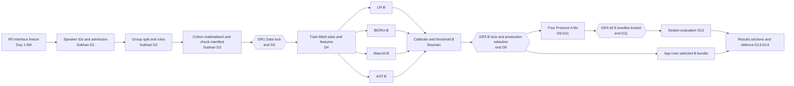

# EchoProof — Revised Two-Week Parallel Implementation Plan

**Prepared:** 3 November 2026
**Delivery window:** 14 working days. Day 1 is Wed 4 Nov 2026 and Day 14 is Tue 17 Nov 2026.
**Team:** Subhan, Muneeb, Usman, Nouman. There are four people, so up to four Colab accounts and T4 GPUs can run in parallel.
**Status:** This is a plan. It does not record results. It replaces the schedule in Sections 2 and 6–13 of [IMPLEMENTATION_PLAN.md](IMPLEMENTATION_PLAN.md) for the rest of the project. The research contract, metric definitions, leakage rules and honesty requirements in that plan and in [docs/research_contract.md](docs/research_contract.md) **stay in force** unless this document reduces scope explicitly (Section 3).

---

## 1. Where the project stands (start of Day 1)

| Area | State taken over from Phases 0–2 |
|---|---|
| Contract | Problem statement, research contract, decision log and task board exist (Phase 0 closed). |
| Environment | Colab T4 (15 GB VRAM), about 12 GB RAM, Python 3.13, torch 2.11, transformers 5.20. The baseline lock was reproduced (P1-13). Streamlit is **not yet installed** in the lock. |
| Code that can be reused | `data/audio.py` (bounded decoding and windows), `features/acoustic.py` (log-mel `[T,64]` and a 47-column handcrafted vector with 13 MFCCs), `models/lr.py` and `models/bigru.py` (fixture adapters with packed sequences), `contracts.py` (Recording, SplitAssignment, Chunk, PredictionRow, InferenceResult, BundleSpecification, parquet I/O), `artifacts.py` (run folders, atomic writes, manifests), `training/seeding.py`, `benchmark.py`, `budget.py`, Phase 2 adapter, pairing and quality modules. |
| Empty packages | `evaluation/` and `training/` (apart from seeding), `app/` (README only), plus `data/splits`, `data/features`, `data/processed`, `bundles/`. |
| Data | PhonemeDF v1.0.1. There are 28,539 stems, each with genuine audio, a transcript and XTTSv2, ChatterboxTTS, MeloTTS and VITS outputs (142,695 audio files, about 49 GB). One VITS file fails its header check. Stems follow the LibriSpeech pattern `speaker-chapter-utterance` (e.g. `103-1240-0000`). |
| Open Phase 2 issues (gate `not_passed`) | Source admission, machine-readable identity, the P2-07 decode error, duplicate disposition and partitions, and the Phase 3 storage estimate. **Phase R1 below closes all of these.** |
| Storage limits | Drive has about 9.5 GB free (user-supplied on 3 Nov). Colab `/content` scratch has about 115 GB per session. |

---

## 2. Planning principles for the two-week version

1. **Freeze interfaces on Day 1, then work in parallel against fixtures.** Every hand-off between people is a file with a fixed schema (Section 5). Nobody waits for real data to start coding: code is written against `tests/fixtures` and switched to the real cohort when its producer publishes it.
2. **One owner per module, one reviewer per pull request.** Owners stay with the role letters already used in the docs: **A = Subhan** (data and features), **B = Muneeb** (LR, BiGRU, shared trainer), **C = Usman** (WavLM, AST, GPU compute), **D = Nouman** (evaluation, calibration, application, integration).
3. **Use a compact, speaker-grouped research cohort instead of the full 142k files.** Speaker groups replace the slow, uncertain pairing-verification path.
4. **Keep the scientific guarantees and cut the ceremony.** Each task produces one machine-readable evidence JSON in `reports/` and a reviewed PR. The separate review document per task and the multi-file gate packets from Phases 1–2 are dropped.
5. **Any number in this plan is a starting proposal.** Freeze it by recording it in `docs/decision_log.md` before the results that depend on it are seen.

---

## 3. Scope: what stays, what is cut, what is simplified

### Stays mandatory (unchanged from the original plan)

- All four approaches: LR, 2-layer BiGRU, frozen WavLM-Base-Plus with a trained head, and AST with head warm-up **plus real partial fine-tuning** (last two blocks).
- Protocol **B**, strict unseen generator: train on MeloTTS + VITS, validate on XTTS v2 as the unseen family, and keep ChatterboxTTS for the final test only. Protocol **A**, known generators: all four families. That makes **8 final fits**.
- Protocol **D**, corruption: frozen models scored on MP3 at 64 and 128 kbps and on additive noise at 20 and 10 dB SNR.
- Recording-level evaluation using the mean of chunk probabilities, group-disjoint splits fixed before segmentation, and statistics fitted on training data only.
- Separate selection, calibration and operating validation roles, and a locked threshold.
- **The B-before-A firewall.** All B decisions are locked before any A training touches ChatterboxTTS.
- The Streamlit app: WAV/MP3 upload, waveform and log-mel display, assessment with an honestly labelled score, invalid-input states, JSON export, and CLI/UI score parity.
- A group bootstrap CI, a fresh-environment reproduction by a non-implementer, a report of 12 or more pages, and a demo.

### Cut, to be listed in the report as limitations or future work

| Cut item | Original plan section |
|---|---|
| Full-corpus training (142k files). Use the cohort instead. | §5 WP7 |
| Fingerprint-based near-duplicate search with manual review. Only exact byte and PCM hashes are checked inside the cohort. | §6.3 |
| Multi-seed repeats, nested cross-fitting, generator rotations | §4, §7 |
| Training with augmentation, and augmentation ablations | §8 |
| WavLM partial fine-tuning, BiLSTM, ensembles, neural occlusion and attribution | §9, §15 |
| Optional corruptions (gain ±6 dB, 8 kHz resampling) | §11 |
| Container image and hosted deployment. Delivery is a scripted local environment plus a local Streamlit app. | §12 |
| Optional abstention or "inconclusive" band (only `insufficient_audio` and `invalid` states remain) | §10.5 |

### Simplified, recorded as a decision-log amendment on Day 1

| Item | Two-week rule |
|---|---|
| **Grouping unit** | Use the **LibriSpeech speaker ID** parsed from the stem prefix as the source-speaker group. Each group contains the genuine recording and all four TTS outputs of every utterance by that speaker. This satisfies the utterance, source-speaker and genuine/synthetic-relative constraints. Target-voice and reference independence is **not claimed**, and the report must say so. **Verification on Day 1:** the stem format is consistent across all 28,539 stems, and transcripts match for a sample. If the format is inconsistent, use the whole stem as the group and narrow the claim. |
| **Split ratio** | **60/20/20 by speakers** instead of 70/15/15, so that the calibration and operating roles have enough independent genuine speakers. Validation is divided by speaker into selection, calibration and operating roles at 50/25/25. |
| **Cohort size** | Proposal: 10 utterances per training speaker, 20 per validation speaker and 20 per test speaker. Every component of a chosen stem is included. With about 251 speakers this is roughly 3,500 stems × 5 = about 17,500 recordings, stored as 16 kHz FLAC in about 4 GB of shards. Subhan confirms the speaker count and storage on Day 1. If Drive cannot hold it, drop to 8/16/16. All four models in a protocol use **identical** recording IDs. |
| **Hyperparameter search** | LR: the 8-trial grid ({0.01, 0.1, 1, 10} × {none, balanced}). BiGRU, WavLM and AST: one baseline plus one targeted alternative each, **under Protocol B only**. Under Protocol A, the configuration selected for B is reused and only early stopping and the checkpoint are chosen on A selection validation. |
| **Calibration** | Temperature scaling on recording-level log-odds, fitted on the calibration role. The threshold maximises macro F1 on the operating role, following the tie-break rules in the research contract. |
| **Noise for Protocol D** | Fixed-seed synthetic white and pink noise, generated once and hashed. Real noise recordings are a future-work item. |
| **Log-mel storage** | Computed on the fly on GPU from the canonical waveform. Only the train-fitted per-bin mean and std are cached. Pooled WavLM embeddings **are** cached because they are small. |
| **Bootstrap** | 1,000 speaker-level resamples (down from 2,000), paired across models. |

---

## 4. Revised phase structure at a glance

| Revised phase | Days | Covers original phases | Exit gate (owner / reviewer) |
|---|---|---|---|
| **R0 Kick-off and interface freeze** | Day 1 (morning) | §2, §4 contracts | **GR0**: schemas, module ownership, branch rules and the decision-log amendment are merged (Nouman / all) |
| **R1 Data lock** | Days 1–3 | 3, 4, part of 5 | **GR1**: cohort, splits and chunk manifest are locked and leakage tests pass (Subhan / Nouman) |
| **R2 Features and first models** | Days 4–5 | 5, 6, part of 3 (EDA) | **GR2**: LR trained under B, wired into the CLI and app with parity, and the WavLM/AST pipelines run on the real cohort (Muneeb / Nouman) |
| **R3 Protocol B training and lock** | Days 6–9 | 7, 8, 9, 10 (B) | **GR3, the firewall**: four B bundles calibrated, thresholded and locked, and the production model selected (Nouman / all) |
| **R4 Protocol A training and deployment** | Days 9–11 | 10 (A), 12 | **GR4**: eight bundles locked, the app runs the selected B bundle, latency is measured (Nouman / Usman) |
| **R5 Sealed evaluation** | Day 12 | 11 | **GR5**: all panels, corruption and CIs computed from saved predictions (Nouman / Subhan) |
| **R6 Report, reproduction and defence** | Days 12–14 | 13 | **GR6**: non-implementer reproduction, final report, rehearsed demo (all) |

### Critical path and hard blocking dependencies

**Hard "must finish before" rules.** Anything not listed here may run in parallel.

| # | Blocking task | Must be complete before | Reason |
|---|---|---|---|
| H1 | R0 interface freeze (schemas in Section 5) | Any parallel coding against shared files | Prevents incompatible formats and merge conflicts |
| H2 | R1-S1 speaker IDs and admission | R1-S2 split | Groups must exist before the split |
| H3 | **GR1 data lock** (split, cohort, chunk manifest) | Fitting any statistics (imputer, scaler, mel mean/std), real-data EDA, real-data training, embedding extraction | Leakage rule: split first, then segment and fit |
| H4 | R2-S1 train-fitted mel stats and LR feature table | BiGRU-B and LR-B real training | These are their inputs |
| H5 | R1-N1 evaluation package (aggregation, metrics, threshold, calibration) | Any model's checkpoint selection on real data | The selection metric is recording-level macro F1, computed by this code |
| H6 | R1-U2 AST memory and throughput probe | Booking AST-B training sessions | Settles microbatch, precision and epochs |
| H7 | **GR3 B lock**: all four B bundles and the production selection | **Any** Protocol A training, and any extraction or viewing of ChatterboxTTS train/validation data | Firewall in the research contract |
| H8 | R2-N2 bundle format and loader | GR3 (bundles must be loadable to be locked) | The lock record needs bundle hashes |
| H9 | **GR4**: eight bundles locked | Sealed evaluation (R5) | No model choice may be made from test results |
| H10 | R5 sealed evaluation | Report pages 10–11 (results) and the final conclusions | Results come only from saved predictions |

---

## 5. Day-1 interface freeze (R0, all four together, about 3 hours)

Agree these and merge them in a single PR (`r0-interfaces`) before anyone splits off.

| Artifact | Path | Producer → consumers | Required fields |
|---|---|---|---|
| Cohort manifest | `data/manifests/cohort_v1.parquet` | Subhan → all | `recording_id` (`phonemedf:<component>:<stem>`), `stem`, `speaker_id`, `chapter_id`, `component`, `label` (0/1), `generator` (null for genuine), `duration_s`, `canonical_path` (shard + key), `pcm_sha256`, `retained`, `exclusion_reason` |
| Split manifest | `data/splits/protocol_{A,B}_v1.parquet` | Subhan → all | `protocol_id`, `recording_id`, `group_id` (= speaker), `partition` ∈ {train, val, test}, `val_role` ∈ {selection, calibration, operating, null}, `split_sha256` |
| Chunk manifest | `data/processed/chunks_v1.parquet` | Subhan → all | `chunk_id`, `recording_id`, `start_sample`, `end_sample`, `valid_samples`, `mode` ∈ {eval}. Training crops are random per epoch and seeded, so they are not stored. |
| Canonical audio | `data/processed/cohort_v1/shard_XX.tar` (FLAC, 16 kHz, mono float→int16) plus `index.parquet` | Subhan → all | Each person copies the shards to `/content` at session start. Nobody streams 17k files from Drive. |
| Chunk score / prediction rows | `runs/<run_id>/predictions_{chunks,recordings}.parquet` | Muneeb/Usman → Nouman | Reuse `ChunkScore` and `PredictionRow` from `contracts.py`. `raw_score` = mean P(TTS). |
| Model adapter API | `src/echoproof/models/base.py` | Nouman defines; Muneeb and Usman implement | `load(bundle_dir)`, `score_chunks(waveforms: list[np.ndarray]) -> np.ndarray[P(TTS)]`, `metadata` |
| Bundle layout | `bundles/<bundle_id>/` | Nouman defines; model owners fill | `bundle.json` (model, protocol, seed, config, hashes, label map, chunk policy, aggregation, temperature, threshold, schema version), weights, processor revision, feature stats, `checksums.sha256` |
| Experiment ledger | `reports/ledger.csv` | Everyone appends; Nouman owns | run_id, owner, model, protocol, config hash, split hash, seed, epochs, best epoch, stop reason, val macro F1/EER/FPR, GPU minutes, peak VRAM, status (including failed runs) |

**Module ownership.** This avoids two people editing the same file.

| Owner | Files they create or modify |
|---|---|
| Subhan | `data/cohort.py`, `data/splits.py`, `data/chunks.py`, `data/corruption.py`, `features/stats.py`, `reports/eda/*`, `scripts/r1_*.py`, tests `test_r1_*` |
| Muneeb | `training/trainer.py`, `training/datasets.py`, `models/lr.py`, `models/bigru.py`, `configs/models/{lr,bigru}.yaml`, tests `test_r2_lr*`, `test_r3_bigru*` |
| Usman | `features/pretrained.py`, `models/wavlm_head.py`, `models/ast_detector.py`, `configs/models/{wavlm,ast}.yaml`, tests `test_r2_wavlm*`, `test_r3_ast*` |
| Nouman | `evaluation/*.py`, `models/base.py`, `inference.py`, `bundle.py`, `app/main.py`, `cli.py` (new subcommands only), tests `test_r1_eval*`, `test_r2_app*` |

**Git workflow.** Each person works on short-lived branches named `r<phase>-<name>-<topic>`. Every PR gets one reviewer, taken from the task tables. `main` must always pass `pytest -q` on the fixtures. Colab notebooks only call `src/` modules, with one notebook per task group (`notebooks/R*_*.ipynb`).

**Rhythm.** A 15-minute stand-up every day covers what was merged, what is blocked and who needs a GPU. There is a 30-minute gate review at the end of Days 3, 5, 9, 11 and 12.

---

## 6. Phase-by-phase task tables

Each task lists its owner, its reviewer, its dependencies ("needs") and what it holds up ("blocks"). Tasks marked **∥** have no dependency on other people's same-phase tasks and can start immediately.

### Phase R1: Data lock (Days 1–3)

The **critical path runs through Subhan**. The other three build their full pipelines on fixtures, so that real data plugs straight in on Day 4.

| ID | Task | Owner / reviewer | Days | Needs | Blocks | Done when |
|---|---|---|---|---|---|---|
| R1-S1 | **Admission and identity.** Parse `speaker-chapter-utterance` from all stems and check the format holds for every one. Count speakers and utterances per speaker. Cross-check that a sample of transcripts matches the stems. Resolve the one VITS header error by excluding that stem across **all** components and recording why. Confirm all 5 components exist per stem. Record the ChatterboxTTS-is-TTS decision from the source evidence. | Subhan / Nouman | D1 | R0 | R1-S2 | `reports/r1/admission.json` gives the speaker count, per-speaker histogram and exclusions. Phase 2 issues 1–3 are closed in the decision log. |
| R1-S2 | **Group split and validation roles.** Assign speakers to train/val/test 60/20/20 deterministically (seed 42), balancing utterance counts. Divide validation speakers 50/25/25 into selection, calibration and operating roles. Derive the Protocol B filter (train = genuine + Melo + VITS; val = genuine + Melo + VITS + XTTS, with XTTS tagged unseen; test = genuine + Chatterbox, plus known-family panels) and the Protocol A filter (all families in every partition). | Subhan / Nouman | D2 | R1-S1 | R1-S3, R1-N3 | Split parquet files are written with their hashes. Every speaker appears in exactly one partition. |
| R1-S3 | **Cohort sampling and materialisation.** Sample N stems per speaker (Section 3), with the same stems for every component. Decode, convert to mono, resample to 16 kHz once (pinned resampler), check finite values, compute PCM SHA-256 hashes, and **check exact duplicates inside the cohort** (keep one representative per group and quarantine any label conflicts). Write FLAC tar shards, the index and the eval chunk manifest (4 s windows at a 2 s stride, a final tail window, and short clips padded right with their true `valid_samples`). | Subhan / Muneeb | D2–D3 | R1-S2 | **GR1** | Shards fit within the Drive budget. Chunk manifest has no orphan chunks. Storage estimate written (closes Phase 2 issue 5). |
| R1-S4 | **Leakage tests** (pytest plus a script on the real manifests). No speaker, stem or PCM hash crosses partitions. Each recording appears once per protocol. B train and val contain no Chatterbox. Every metric panel has both classes. Final-test paths cannot be reached unless `--sealed` is passed. | Subhan / Nouman | D3 | R1-S3 | **GR1** | `reports/r1/leakage.json` reports zero violations. |
| R1-M1 ∥ | **Shared trainer.** Config-driven `Trainer` with AdamW, a scheduler, gradient clipping, AMP (fp16 with an unscale step before clipping), gradient accumulation (correctly weighting the final partial group), early stopping on recording macro F1 at a 0.5 threshold, separate best and latest checkpoints, full resume (model, optimiser, scheduler, scaler, RNG, epoch), and ledger logging. Datasets: one seeded random 4 s crop per recording per epoch for training, and fixed eval chunks from the chunk manifest. | Muneeb / Usman | D1–D3 | R0 | R3 neural training | Fixture test: the model overfits 16 clips, and resuming reproduces the next-epoch loss. |
| R1-M2 ∥ | **LR pipeline upgrade.** Move from the fixture adapter to the production adapter: per-chunk handcrafted features, equal **recording** weights across crops, imputer → scaler → LR, and the class-1 column taken from `classes_`. Implement the 8-trial grid runner. Keep the 13-MFCC / 47-column schema and record that choice. | Muneeb / Subhan | D2–D3 | R0 | R2-M1 | Save, reload and score parity on fixtures at ≤1e-12. |
| R1-U1 ∥ | **Pin the pretrained models.** Pin the revisions and processor files for `microsoft/wavlm-base-plus` and `MIT/ast-finetuned-audioset-10-10-0.4593`. Record the licences. Write a **WavLM extractor** that maps waveform lengths to hidden lengths, does masked mean pooling (plus mean+std as the alternative) and runs in eval mode without gradients. Include a single-vs-batched parity test on short and full crops. | Usman / Muneeb | D1–D2 | R0 | R2-U1 | Parity holds within tolerance. The trainable parameter list contains only the head. |
| R1-U2 ∥ | **AST wrapper and feasibility probe on the T4.** Replace the head with 2 classes and check that the loading warnings list only head tensors. Add freeze and unfreeze controls for the last 2 blocks plus the final norm, and print the trainable names and counts. Run forward and backward passes at microbatch 2, 4 and 8 in fp16. Measure clips/s and peak VRAM, then estimate time per epoch for the B and A training sets. | Usman / Muneeb | D2–D3 | R1-U1 | AST-B scheduling (H6) | `reports/r1/ast_probe.json` and a GPU-hours budget for all 8 fits plus extraction, with a 25% reserve. |
| R1-N1 ∥ | **Evaluation package.** `evaluation/aggregate.py` (mean P(TTS) per recording, one row each), `metrics.py` (accuracy, precision, recall, genuine recall, macro F1, FPR, FNR, ROC-AUC, interpolated EER, AP, confusion matrix, Brier score, log loss), `calibrate.py` (temperature on log-odds with epsilon clipping), `threshold.py` (macro-F1 search over all score-induced partitions, with the contract's tie-breaks and `score >= threshold`), `bootstrap.py` (paired speaker-group bootstrap). | Nouman / Subhan | D1–D3 | R0 | Real checkpoint selection (H5), GR3 | Fixture tests pass for perfect, tied, reversed, single-class, no-positive and non-finite cases. |
| R1-N2 ∥ | **Inference path and app skeleton.** `inference.predict_recording(bytes, bundle)` does bounded decoding (25 MiB / 60 s), quality checks (under 1 s of audio gives `insufficient_audio`), canonical chunks, the adapter, mean aggregation, calibration and the decision, and returns `InferenceResult`. `app/main.py` (Streamlit) offers upload, playback, a waveform with labelled time axis, a log-mel image with labelled Hz/time axes and colour bar, an Analyze button, error states and JSON download. Until the LR bundle exists it shows a **clearly labelled mock**. Add Streamlit to the environment lock. | Nouman / Usman | D2–D3 | R0 | R2-N1 | The app runs locally on fixtures, and malformed, empty and oversized files give proper messages. |
| R1-N3 | **Precision worksheet.** From the split manifests, count genuine and TTS recordings and independent speakers per validation role and per test panel. Tabulate the expected FPR CI width at error rates of 2, 5 and 10%. If the calibration or operating roles are too thin, raise this with Subhan **before GR1** so the role ratios or utterances per speaker can change. | Nouman / Subhan | D3 | R1-S2 | GR1 | `reports/r1/precision_worksheet.md` |

**GR1 (end of Day 3).** Subhan presents admission, splits, cohort and leakage results. Nouman reviews. Once it passes, the split hash is **frozen**. Any later change requires a decision-log entry and refitting of everything downstream.

### Phase R2: Features and first models (Days 4–5)

| ID | Task | Owner / reviewer | Days | Needs | Blocks | Done when |
|---|---|---|---|---|---|---|
| R2-S1 | **Train-fitted statistics and LR features.** Compute the per-bin log-mel mean and std over valid training frames only, per protocol. Note that A's stats include Chatterbox training frames, so **A stats are computed after GR3**. Extract the handcrafted feature table for all B eval chunks and training crops, using a fixed crop bank for LR. | Subhan / Muneeb | D4 | GR1 | LR-B, BiGRU-B (H4) | Stats and features are saved with the split and schema hashes. |
| R2-S2 | **Training-partition EDA (B train only, no Chatterbox).** Class and generator counts by partition, duration histograms, paired waveforms and log-mels on a shared scale, RMS and leading/trailing silence, MFCC distributions, sample rate/codec/channel, speaker group sizes and the exclusion table. Each figure is saved as PNG and SVG with a two-line interpretation. | Subhan / Nouman | D4–D5 | GR1 | Report pages 4–5 | `reports/eda/` contains at least 6 figure families. |
| R2-S3 | **Shortcut probe.** A metadata-only LR (duration, RMS, silence fraction, original sample rate) trained on B train and scored on B selection validation. Also compare duration-matched subsets. | Subhan / Muneeb | D5 | R2-S1, R1-N1 | Report page 5 interpretation | A memo states whether any nuisance variable separates the classes. |
| R2-M1 | **LR-B.** Run the 8-trial grid on B train, select on B selection validation (recording macro F1 at 0.5), add majority-class and random-score references, check convergence, export standardised coefficients, and save the adapter. | Muneeb / Subhan | D4–D5 | R2-S1, R1-N1 | R2-N1, GR3 | Ledger rows for all 8 trials. Selected LR saved. |
| R2-M2 | **BiGRU diagnostics.** Overfit 32–64 real training clips (then discard the run), check valid frame lengths, mask sums, and invariance to padded batch neighbours. | Muneeb / Usman | D5 | R1-M1, R2-S1 | R3-M1 | Diagnostic JSON. |
| R2-U1 | **WavLM embedding cache (B scope).** Extract pooled embeddings (mean and mean+std) for B train crop banks, plus **all val** and B-test genuine chunks. **Do not extract Chatterbox recordings.** Use atomic writes with keys built from the audio hash, chunk coordinates, revision and pooling. Check cached against direct scores on 50 chunks. | Usman / Muneeb | D4–D5 | GR1, R1-U1 | R3-U1 | Cache inventory, with extraction time and size logged. |
| R2-U2 | **AST-B frozen warm-up starts.** Train the 2-class head with a frozen backbone in eval mode for 1–3 epochs on B train, and save the warm-up checkpoint as the "frozen AST" comparison. | Usman / Muneeb | D5 | GR1, R1-U2, R1-M1 | R3-U2 | Warm-up checkpoint and ledger row. |
| R2-N1 | **LR end-to-end integration.** Build a provisional LR-B bundle, then wire `predict_recording` to the CLI (`python -m echoproof.cli predict --bundle … --audio …`) and the app. **Remove the mock.** Write a parity test: the same bytes through the CLI, the evaluator and the app must give identical scores. | Nouman / Usman | D5 | R2-M1, R1-N2 | GR2 | The parity test passes, and the app shows a real LR assessment. |
| R2-N2 | **Bundle writer, loader and lock record.** `bundle.py` writes and validates `bundle.json` plus checksums, rejects missing or mismatched components, and loads only local trusted paths. `lock.py` writes `locks/B_lock.json` (bundle hashes, split hash, selection rationale, test-access log). | Nouman / Muneeb | D4–D5 | R0 | GR3 (H8) | Fixture bundles round-trip, and a corrupted file is rejected. |

**GR2 (end of Day 5).** LR-B scores real B validation, the app shows a real LR result with parity, and the WavLM cache and AST warm-up are running. Muneeb presents and Nouman reviews.

### Phase R3: Protocol B training and B lock (Days 6–9)

GPU-heavy. **Use all four Colab accounts.** If Usman's account is throttled, Subhan or Nouman runs the next AST or WavLM notebook; every notebook must be runnable by any teammate from the Drive shards.

| ID | Task | Owner / reviewer | Days | Needs | Blocks | Done when |
|---|---|---|---|---|---|---|
| R3-M1 | **BiGRU-B.** Baseline: 64-mel → 2×BiGRU(128) → masked mean pooling → dropout 0.3 → 2 logits, AdamW 1e-3, weight decay 0.01, batch 32, at most 20 epochs, patience 3, ReduceLROnPlateau. Then **one** alternative (hidden 64 **or** lr 3e-4). Select on B selection validation. | Muneeb / Usman | D6–D8 | R2-M2 | GR3 | Two ledger rows, best checkpoint, recording predictions on all B validation roles. |
| R3-M2 | **LR-B finalisation and ablation.** With and without energy/silence features as a bounded ablation, plus a coefficient table. Write the LR and BiGRU adapters against `models/base.py`. | Muneeb / Subhan | D6 | R2-M1 | GR3 | Adapters load from bundles. |
| R3-U1 | **WavLM-head-B.** Linear(768,128) → GELU → Dropout 0.2 → Linear(128,2) on cached embeddings, AdamW 1e-3, at most 20 epochs. Compare mean pooling with mean+std pooling, and select. Check direct-waveform scoring against cached scoring on validation. | Usman / Muneeb | D6–D7 | R2-U1 | GR3 | Two runs, parity check passed, adapter that scores **raw waveforms** (the encoder is inside the bundle). |
| R3-U2 | **AST-B partial fine-tuning (the long pole).** From the warm-up checkpoint, unfreeze the last 2 blocks, the final norm and the head. Rebuild the optimiser groups (backbone 1e-5, head 1e-4, weight decay 0.01), use effective batch 16 via accumulation, at most 6–10 epochs at the size set by R1-U2, with warm-up then cosine decay. Show non-zero gradients and changed checksums in the unfrozen blocks, and unchanged checksums in the frozen ones. Make **one** alternative, only if the budget allows. Run in overnight sessions with resume. | Usman / Muneeb | D6–D9 | R2-U2, R1-M1 | GR3 | Adaptation evidence JSON. Warm-up and adapted predictions on the same validation recordings. |
| R3-S1 | **Corruption suite builder.** MP3 at 64 and 128 kbps through ffmpeg with fixed argument arrays and a round-trip check. Noise at 20 and 10 dB SNR (global power, fixed seeds, white and pink, hashed). Parent IDs are kept. Test on fixtures and a validation sample. **Do not run it on test data yet.** | Subhan / Nouman | D6–D7 | GR1 | R5 | `data/corruption.py` with tests. Specifications frozen in the decision log. |
| R3-S2 | **Report drafting:** pages 3–6 (data, cleaning, EDA, methodology diagram, grouping, protocols, leakage tests). | Subhan / Muneeb | D7–D9 | R2-S2, R2-S3 | R6 | Draft in `reports/final/`. |
| R3-N1 | **Calibration and thresholds for each B model, as soon as each finishes.** Fit the temperature on the calibration role. Evaluate raw against calibrated scores (Brier, log loss, reliability) on the operating role. Choose the macro-F1 threshold on the operating role. If calibration does not help, the app label stays "model score". | Nouman / Usman | D7–D9 | Each B model, R1-N1 | GR3 | Calibration JSON and reliability plot per model. |
| R3-N2 | **Latency harness on the named demo device.** Name the device first, closing OPEN-004. Measure batch 1, warm, 1/4/10/30/60 s clips, p50 and p95, broken down by stage, plus cold start. | Nouman / Usman | D7–D8 | R2-N1 | Production selection | `reports/r3/latency_*.json` for every B candidate. |
| R3-ALL | **GR3 B lock (end of Day 9, all four people).** Build and lock four B bundles. Apply the contract's selection rule (unseen-XTTS selection macro F1, then lower EER, then lower FPR, then lower p95 latency), check deployment qualification, write `locks/B_lock.json` and record the decision. **From this moment, no B artefact may change.** | Nouman / all | D9 | All R3 tasks, R2-N2 | **All of R4 (H7)** | Lock file committed. Production bundle ID announced. |

**Fallback if AST-B is late.** Under the default rule GR3 waits for AST. If AST-B is still training at the end of Day 9:

1. Stop at the best checkpoint so far, as long as the adaptation evidence already shows the backbone weights changed.
2. Lock it with the epoch count disclosed.
3. Never start Protocol A training while any B model is unlocked. A missed lock costs at most half a day.

### Phase R4: Protocol A training, A lock and deployment (Days 9–11)

Protocol A **reuses each model's B-selected configuration**. The only development choice in A is early stopping and the checkpoint on A selection validation, which removes the search cost. The four fits run in parallel on four accounts.

| ID | Task | Owner / reviewer | Days | Needs | Blocks | Done when |
|---|---|---|---|---|---|---|
| R4-S1 | **A feature preparation.** A train mel stats, LR feature table for A (adding Chatterbox train and val chunks), and the Chatterbox chunk list for Usman's extraction. | Subhan / Muneeb | D9–D10 (start right after GR3) | **GR3** | R4-M1, R4-U1 | Stats and features saved with hashes. |
| R4-U0 | **WavLM extraction for Chatterbox train and val** (and test genuine/known-family chunks if any are missing), written to the cache. | Usman / Subhan | D10 | GR3 | R4-U1 | Cache inventory updated. |
| R4-M1 | **LR-A and BiGRU-A** with the B-selected configurations. | Muneeb / Usman | D10–D11 | R4-S1 | GR4 | Ledger rows and checkpoints. |
| R4-U1 | **WavLM-head-A and AST-A** (warm-up, then partial fine-tuning with the B recipe, plus adaptation evidence). | Usman / Muneeb | D10–D11 | R4-U0, R4-S1 | GR4 | Ledger rows, checkpoints, adaptation evidence. |
| R4-N1 | **A calibration, thresholds and bundles** for all four, then `locks/A_lock.json`. | Nouman / Subhan | D11 | R4-M1, R4-U1 | **GR4 (H9)** | Eight locked bundles. |
| R4-N2 | **Deploy the production B bundle in the app.** Warn when the score type is uncalibrated, show the scope statement, clean up temporary files on success, error and timeout, add no caching of user audio, add a busy state, and test keyboard use and accessibility labels. Run the full app acceptance list (§12 of the original plan). | Nouman / Usman | D10–D11 | GR3 | GR6 | Acceptance checklist ticked. |
| R4-N3 | **Fresh-environment install script and README.** `scripts/setup_env` plus checksum-verified bundle and model retrieval steps. Test on a clean Colab VM. | Nouman / Muneeb | D11 | R4-N2 | R6-REPRO | A clean VM runs the CLI predict command and the app. |
| R4-M2 / R4-U2 | **Report drafting.** Muneeb: page 7 (handcrafted features, LR, log-mel, BiGRU) and the training-procedure part of page 9. Usman: page 8 (WavLM and AST, frozen and trainable parameters, adaptation evidence) and the compute part of page 9. | Muneeb, Usman | D10–D11 | Own runs | R6 | Drafts. |

**GR4 (end of Day 11).** Eight bundles are locked, the app runs the production B bundle, latency is measured, and the fresh install works.

### Phase R5: Sealed evaluation (Day 12)

| ID | Task | Owner / reviewer | Days | Needs | Blocks | Done when |
|---|---|---|---|---|---|---|
| R5-S1 | **Generate the corruption copies of the locked test recordings** (four conditions), keeping parent IDs. | Subhan / Nouman | D12 AM | GR4, R3-S1 | R5-N1 (D panel) | Corrupted shards hashed. |
| R5-N1 | **Sealed run** with `cli evaluate --suite sealed --lock …`. Verify bundle and test-manifest hashes, score every test recording with all eight bundles, and check denominators, failures and finiteness **before** computing metrics. Panels: A known families; B known and unseen (Chatterbox); D corruption, paired. Then the paired speaker bootstrap (1,000 resamples) and confusion, ROC, PR and reliability plots. | Nouman / Subhan | D12 | **GR4** | R6 results pages (H10) | `reports/final/results/` holds predictions, metrics JSON, tables and plots, plus the test-access log. |
| R5-M1 / R5-U1 | **Error taxonomy.** Muneeb takes LR and BiGRU, Usman takes WavLM and AST. Break errors down by generator, duration and silence/quality. Pick demo examples, including one failure. **No tuning after this.** | Muneeb, Usman | D12 PM | R5-N1 | Report page 11 | Error notes and demo clip list. |

**GR5.** Every number in the report traces back to a saved predictions file. Missing values are written as "not measured".

### Phase R6: Report, reproduction and defence (Days 12–14)

| ID | Task | Owner / reviewer | Days | Needs | Done when |
|---|---|---|---|---|---|
| R6-REPRO | **Independent reproduction.** **Muneeb** (not the evaluation owner) follows the README on a clean VM, reloads all 8 bundles, regenerates the comparison tables from the saved predictions and runs the demo. **Subhan** re-runs the leakage test script against the final manifests. | Muneeb + Subhan / Nouman | D13 | GR5, R4-N3 | Reproduction log with any discrepancies listed. |
| R6-RPT | **Final report (12 pages).** Page owners: **Nouman** pp. 1, 10, 12 (problem, results comparison, application, latency, conclusions); **Subhan** pp. 3–6; **Muneeb** pp. 2, 7 (related work, LR and BiGRU); **Usman** pp. 8, 9, 11 (pretrained models, tuning, compute, calibration, robustness, errors, limitations). Each page is reviewed by a different member. | All | D12–D14 | GR5 for pp. 10–11 | At least 10 substantive pages, a methodology diagram, a four-model × two-protocol table, the limitations list from Section 3 and the contribution log. |
| R6-CARD | Model card (production bundle), dataset card update, contribution log and a final decision-log update (all deviations). | Nouman (model card), Subhan (data card), all (contributions) | D13–D14 | GR5 | Committed. |
| R6-DEMO | **Six-minute demo rehearsal** (×2) with an offline backup video. Every member can answer the defence questions in §13 of the original plan. | All / Nouman coordinates | D14 | R4-N2, R5 | Rehearsed twice, backup recorded. |
| R6-CHECK | Final acceptance checklist (Section 9). Unmet items are listed honestly. | Nouman / all | D14 PM | Everything | Checklist committed. |

---

## 7. Who does what, day by day

| Day | Subhan (data and features) | Muneeb (LR, BiGRU, trainer) | Usman (WavLM, AST, GPU) | Nouman (evaluation, app, integration) |
|---|---|---|---|---|
| **D1 Wed 4 Nov** | R0 (AM); **R1-S1 admission and speaker IDs** | R0; R1-M1 trainer | R0; R1-U1 pin models, WavLM extractor | **Leads R0**; R1-N1 metrics; decision-log amendment |
| **D2 Thu 5 Nov** | **R1-S2 split and roles**; start R1-S3 | R1-M1; R1-M2 LR pipeline | R1-U1 parity; R1-U2 AST probe | R1-N1 calibration/threshold; R1-N2 inference skeleton |
| **D3 Fri 6 Nov** | **R1-S3 materialise; R1-S4 leakage**; GR1 | R1-M1 resume test; R1-M2; review R1-S3 | R1-U2 budget report | R1-N2 app skeleton; R1-N3 worksheet; **GR1 review** |
| **D4 Sat 7 Nov** | **R2-S1 stats and LR features**; R2-S2 EDA | R2-M1 LR-B grid | R2-U1 WavLM cache (B) | R2-N2 bundle and lock code |
| **D5 Sun 8 Nov** | R2-S2 EDA; R2-S3 shortcut probe | R2-M1 finish; R2-M2 BiGRU diagnostics | R2-U1 finish; **R2-U2 AST warm-up** | **R2-N1 LR in app with parity**; GR2 |
| **D6 Mon 9 Nov** | R3-S1 corruption builder | R3-M1 BiGRU-B baseline; R3-M2 | R3-U1 WavLM-head-B; **R3-U2 AST-B FT** (overnight) | Ledger upkeep; app polish |
| **D7 Tue 10 Nov** | R3-S1 finish; R3-S2 report pp. 3–6 | R3-M1 BiGRU-B alternative | R3-U1 finish; R3-U2 continues | R3-N1 calibrate LR-B and WavLM-B; R3-N2 latency |
| **D8 Wed 11 Nov** | R3-S2; spare GPU for AST runs if needed | R3-M1 finish; BiGRU adapter | **R3-U2 AST-B FT** | R3-N1 BiGRU-B; R3-N2 finish |
| **D9 Thu 12 Nov** | R3-S2; then **R4-S1 A features** after GR3 | Review AST evidence | **R3-U2 finish**; AST adapter | R3-N1 AST-B; **GR3 B lock and production selection** (all) |
| **D10 Fri 13 Nov** | R4-S1 finish; help with A runs | R4-M1 LR-A and BiGRU-A; R4-M2 page 7 | R4-U0 Chatterbox extraction; R4-U1 WavLM-A and AST-A | R4-N2 production bundle in app |
| **D11 Sat 14 Nov** | Report pp. 3–6 final; data card | R4-M1 finish; page 7 and part of page 9 | R4-U1 AST-A finish; page 8 | **R4-N1 A lock**; R4-N3 fresh install; **GR4** |
| **D12 Sun 15 Nov** | R5-S1 corruption copies | R5-M1 error taxonomy (LR, BiGRU) | R5-U1 error taxonomy (WavLM, AST) | **R5-N1 sealed evaluation**; GR5 |
| **D13 Mon 16 Nov** | Leakage re-check; pages 3–6 polish | **R6-REPRO independent reproduction** | Pages 8, 9, 11 | Pages 1, 10, 12; model card |
| **D14 Tue 17 Nov** | Review pages 7–8; demo rehearsal | Review pages 10–12; demo rehearsal | Review pages 3–6; demo rehearsal | Report assembly; R6-CHECK; demo (lead) |

Working through the weekend is assumed, because 14 consecutive days are needed. If the team has only 10 working days, apply the reductions in Section 8 rows 2–3 from Day 1.

---

## 8. Risk register and pre-agreed cuts

| Trigger (check at which point) | Owner | Response, in order |
|---|---|---|
| Stems are not all LibriSpeech format, or speaker counts are odd (D1) | Subhan | Group by whole stem, narrow the claim to utterance independence, record the decision. The schedule is unchanged. |
| The cohort will not fit on Drive (D2) | Subhan | Reduce to 8/16/16 utterances per speaker. If still too large, cap each recording at its first 20 s and record this as an explicit research eligibility rule, never as silent truncation. |
| Calibration or operating role has too few genuine speakers (D3 worksheet) | Nouman | Move to 55/22.5/22.5, or increase utterances per validation speaker. Never use test data. |
| The AST probe shows A+B partial fine-tuning exceeds the budget (D3) | Usman | Lower the microbatch and raise accumulation, cut A and B epochs to 4–6, train on a 50% speaker-stratified subset of training **identically for all four models in that protocol**. Keep two unfrozen blocks if possible, and never fewer than one. |
| Validation accuracy looks suspiciously perfect (any time) | Subhan + model owner | Stop tuning. Check the shortcut probe, duration, silence and duplicates before continuing. |
| Colab GPU quota runs out on an account | Whoever is affected | Hand the notebook to another teammate's account; checkpoints and resume make this safe. LR, WavLM-head and evaluation are CPU-friendly. |
| A B model is not locked by the end of D9 | Nouman | Apply the AST fallback (R3). A training slips by at most half a day; the D14 buffer absorbs it. |
| An A fit fails on D11 | Model owner | Report that A fit as "not completed" in the table. It is a disclosed unmet requirement, and nothing is fabricated. B and the app are unaffected. |
| App and CLI scores diverge | Nouman | Release blocker: fix before GR4, or demo with the CLI and disclose. |

**Order of cuts if the schedule slips** (never cut anything below row 5):
1. Shortcut-probe extras (duration-matched subset), the LR energy ablation, and the one AST alternative.
2. The BiGRU and WavLM alternatives. Train only the baseline configuration.
3. Shrink the training cohort identically within each protocol.
4. Cut AST epochs. Keep the warm-up and **demonstrated** partial adaptation.
5. **Never cut:** group-safe splits, the B-before-A firewall, the four models, recording-level evaluation, the locked threshold, the working app with parity, and honest reporting of anything unmet.

---

## 9. Final acceptance checklist (tick on Day 14)

- [ ] Decision-log amendment for this plan: speaker grouping, 60/20/20, cohort size, A reuses B configurations, cuts.
- [ ] Phase 2 handoff issues 1–5 closed or explicitly disclosed.
- [ ] Cohort, splits and chunk manifests hashed. Leakage report shows zero violations.
- [ ] Six or more EDA figure families with interpretations, plus a shortcut-probe memo.
- [ ] LR, BiGRU, WavLM-head and partially fine-tuned AST trained under **B and A** (8 bundles), each with a ledger entry.
- [ ] AST adaptation evidence: changed weights in the unfrozen blocks, warm-up compared with adapted.
- [ ] The B lock was recorded **before** any A training (timestamps in the lock files).
- [ ] Calibration on the calibration role and the threshold on the operating role, for every bundle.
- [ ] Sealed results: A, B-known, B-unseen and D-corruption panels with all metrics, supports, failures and bootstrap CIs.
- [ ] The app handles WAV/MP3 upload, waveform, spectrogram, assessment, the honest score label, invalid-input messages and JSON export. It shows no mock output, and CLI/UI parity holds.
- [ ] Latency p50/p95 on the named demo device, with any miss of the target disclosed.
- [ ] Fresh-VM reproduction by a non-implementer is logged.
- [ ] Report of at least 10 substantive pages (target 12), model card, data card, contribution log and limitations list.
- [ ] Demo rehearsed twice, offline backup recorded.

---

## 10. Relationship to existing documents

- [IMPLEMENTATION_PLAN.md](IMPLEMENTATION_PLAN.md) stays the authority for technical definitions: metric contract (§11), inference schema (§12), configuration schema (§14) and risk rationale (§15–16). This plan replaces only its **schedule, staffing, phase boundaries and the scope listed in Section 3**.
- [docs/research_contract.md](docs/research_contract.md) stays binding. The simplifications in Section 3 must go into [docs/decision_log.md](docs/decision_log.md) as a dated amendment on Day 1, before any model results exist, so they count as pre-registered deviations and not post-hoc changes.
- The Phase 2 evidence under `reports/phase2/` and `data/manifests/phase2_*` is the input to R1-S1. It is not modified.
